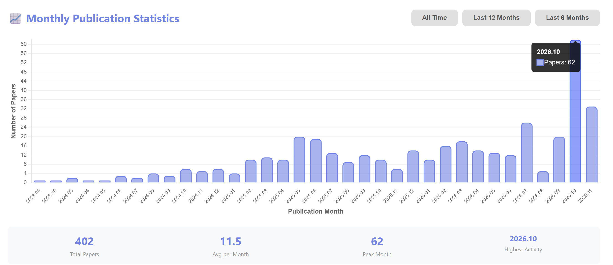

# ✨ Awesome Issue Resolution

<div align="center">

**Advances and Frontiers of LLM-based Issue Resolution in Software Engineering A Comprehensive Survey**

[](https://github.com/DeepSoftwareAnalytics/Awesome-Issue-Resolution)
[](https://github.com/DeepSoftwareAnalytics/Awesome-Issue-Resolution/fork)
[](https://github.com/sindresorhus/awesome)
[](https://deepsoftwareanalytics.github.io/Awesome-Issue-Resolution/paper/)
[](https://arxiv.org/abs/2601.11655)
[](https://huggingface.co/papers/2601.11655)
[](https://deepsoftwareanalytics.github.io/Awesome-Issue-Resolution/tables/)
[](https://deepsoftwareanalytics.github.io/Awesome-Issue-Resolution/cite/)
[](https://github.com/DeepSoftwareAnalytics/Awesome-Issue-Resolution/graphs/contributors)


[**📖 Documentation Website**](https://deepsoftwareanalytics.github.io/Awesome-Issue-Resolution/) | [**📄 Full Paper**](https://deepsoftwareanalytics.github.io/Awesome-Issue-Resolution/paper/) | [**📋 Tables & Resources**](https://deepsoftwareanalytics.github.io/Awesome-Issue-Resolution/tables/) | [**📖 Citation**](#-citation)

**🎙️ Interactive Exploration:**

[](https://notebooklm.google.com/notebook/2b70100e-9d5a-46db-96f5-6ccb7b53890a)
[](https://discord.gg/awBHrRJx)
[](https://github.com/DeepSoftwareAnalytics/Awesome-Issue-Resolution/issues)


</div>

---

## 📖 Abstract

Based on systematic review of **397 papers and online resources**, this survey establishes a holistic theoretical framework for Issue Resolution in software engineering. We examine how **Large Language Models (LLMs)** are transforming the automation of GitHub issue resolution. Beyond the theoretical analysis, we have curated a comprehensive collection of datasets and model training resources, which are continuously synchronized with our GitHub repository and project documentation website.

## 📰 News

<!-- START NEWS -->
> We continuously update the paper list in real time. If your work is unintentionally missing, please let us know by opening an issue. You are also welcome to cite [](https://deepsoftwareanalytics.github.io/Awesome-Issue-Resolution/cite/) our survey to support this project.

### Recent Papers

<!-- START_RECENT_PAPERS -->
- **ELITE**: Evaluation-Free Recursive Self-Improvement for Coding Agents [](https://arxiv.org/abs/2611.21056)
- **FlowPlan**: FlowPlan: Reducing the Token Cost of Coding Agents with Abstraction-Guided Planning and Verification [](https://arxiv.org/abs/2611.13241)
- **Longtail-SWE**: Longtail-SWE: High-Quality SWE Tasks for Underrepresented Languages [](https://arxiv.org/abs/2611.10304)
- **NINJA**: NINJA: A Navigator-Inspector Joint Architecture for Context-Efficient Issue Localization [](https://arxiv.org/abs/2611.10027) [](https://github.com/wantbook-book/NINJA)
- **Robo-SWE**: Robo-SWE: An Executable Issue-Resolution Dataset Mined from Robot Software Repositories [](https://arxiv.org/abs/2611.16116)
- **SWE-Growth**: SWE-growth: Teacher-Guided Adaptive Self-Play for Software Engineering Agents [](https://arxiv.org/abs/2611.23876)
- **Compact-Bench**: Compact-Bench: Measuring What Context Compaction Costs Long-Horizon Coding Agents [](https://arxiv.org/abs/2610.31710) [](https://github.com/cai-jianfeng/compact-bench)
- **SWE-CC**: Correct Code, Broken Contributions? SWE-CC: Benchmarking Repository Policy Compliance for Coding Agents [](https://arxiv.org/abs/2610.06193)
- **JevCoder**: JevCoder: When Does Decision Delegation Pay Off in Code Repair? [](https://arxiv.org/abs/2610.19596)
- **SWE-Bench Pro V2**: SWE-Bench Pro V2: A Cleaner, Harder-to-Game Coding Benchmark [](https://arxiv.org/abs/2610.24206)
- **SWE-DIVE**: SWE-DIVE: Multi-Turn Coding Agent Evaluation with Dynamic User Simulation [](https://arxiv.org/abs/2610.30047) [](https://github.com/lorenzbrehme/swe-dive_usersim)
- **Know Before Fix**: Know Before Fix: QA-Driven Repository Knowledge Acquisition for Software Issue Resolution [](https://arxiv.org/abs/2607.11111)
- **Steer, Don't Solve**: Steer, Don't Solve: Training Small Critic Models for Large Code Agents [](https://arxiv.org/abs/2606.21811) [](https://github.com/shubhamrgandhi/critic-training) [](https://huggingface.co/code-critic-model)
<!-- END_RECENT_PAPERS -->

### Recent Updates

- **Survey Update (2026-11)**: Our collection has grown to **396 works** on LLM-based GitHub issue resolution, with **62 published in October alone**. Stay tuned for **v2 of our survey, coming soon~**

  

- **Survey Update (2026-08)**: Our repository now covers 281 papers on LLM-based GitHub issue resolution!
- **Survey Update (2026-03)**: Our repository now covers 200+ papers on LLM-based GitHub issue resolution!
- **Survey Update (2026-03)**: Added 21 new papers covering the latest advances in LLM-based issue resolution!
- **Survey Launch (2026-01)**: Our survey paper is now publicly available on arXiv: [https://arxiv.org/abs/2601.11655](https://arxiv.org/abs/2601.11655). It covers 175 papers and resources on LLM-based GitHub issue resolution, with continuously updated datasets and leaderboards!
<!-- END NEWS -->

<!-- START EXPLORE -->
**🔍 Explore This Survey:**

- 📊 **[Data](#-data)**: Evaluation and training datasets, data collection and synthesis methods
  - [📊 Evaluation Datasets](#-evaluation-datasets)
  - [🎯 Training Datasets](#-training-datasets)
  - [📥 Data Collection Methods](#-data-collection)
  - [🔬 Data Synthesis Methods](#-data-synthesis)
- 🛠️ **[Methods](#%EF%B8%8F-methods)**: Training-free (agent/workflow) and training-based (SFT/RL) approaches
  - **Training-free Methods**
    - [🤖 Single-Agent Systems](#-single-agent-systems)
    - [👥 Multi-Agent Systems](#-multi-agent-systems)
    - [🔄 Workflow-Based Methods](#-workflow-based-methods)
    - [🛠️ Tool-Augmented Methods](#%EF%B8%8F-tool-augmented-methods)
    - [🧠 Memory-Enhanced Methods](#-memory-enhanced-methods)
    - [⚡ Inference-Time Scaling](#-inference-time-scaling)
  - **Training-based Methods**
    - [📚 Supervised Fine-Tuning (SFT)](#-supervised-fine-tuning-sft)
    - [🎮 Reinforcement Learning (RL)](#-reinforcement-learning-rl)
- 🔍 **[Analysis](#-analysis)**: Insights into both data characteristics and method performance
  - [📈 Data Analysis](#-data-analysis)
  - [🔍 Methods Analysis](#-methods-analysis)
- 📋 **[Tables & Resources](https://deepsoftwareanalytics.github.io/Awesome-Issue-Resolution/tables/)**: Comprehensive statistical tables and resources
- 📄 **[Full Paper](https://deepsoftwareanalytics.github.io/Awesome-Issue-Resolution/paper/)**: Read the complete survey paper
- 🤝 **[Contributing](#-contributing)**: How to contribute to this project
<!-- END EXPLORE -->

> 🧭 **Survey Exploration Skill**: We provide a local skill at **`./skill/survey-repo-explorer`** to extract categorized paper links from survey READMEs and build a structured knowledgebase under **`./survey2knowledgebase`** for agent-assisted literature exploration.

> 🔎 **Browse & Export**: The full paper database is searchable and exportable at **[deepsoftwareanalytics.github.io/Awesome-Issue-Resolution/admin/](https://deepsoftwareanalytics.github.io/Awesome-Issue-Resolution/admin/)** — filter by category, date, or keyword, and export results as CSV.

<!-- START DEMO -->
<div align="center">


</div>
<!-- END DEMO -->

---

<!-- START PAPERS -->
## 📚 Complete Paper List


> **Total: 397 works** across 14 categories


### 📊 Evaluation Datasets

*Benchmarks for evaluating issue resolution systems*

- `(2026-11)` **SIExBench**: SIExBench: A Benchmark for Automated Repair of Sensitive Information Exposure [](https://arxiv.org/abs/2611.10776)
- `(2026-11)` **Longtail-SWE**: Longtail-SWE: High-Quality SWE Tasks for Underrepresented Languages [](https://arxiv.org/abs/2611.10304)
- `(2026-11)` **Robo-SWE**: Robo-SWE: An Executable Issue-Resolution Dataset Mined from Robot Software Repositories [](https://arxiv.org/abs/2611.16116)
- `(2026-11)` **CompAct-Bench (Working-Context)**: CompAct-Bench: A Benchmark for Working-Context Compaction in Long-Horizon Agent Tasks [](https://arxiv.org/abs/2611.25673)
- `(2026-11)` **BuggyMLE**: BuggyMLE: Scaling Machine Learning Engineering Difficulty with Bug Injection [](https://arxiv.org/abs/2611.25088)
- `(2026-11)` **CR-Bench-v2**: CR-Bench-v2: Evaluating the Real-World Utility of AI Code Review Agents [](https://arxiv.org/abs/2611.02566)
- `(2026-10)` **SWE-CC**: Correct Code, Broken Contributions? SWE-CC: Benchmarking Repository Policy Compliance for Coding Agents [](https://arxiv.org/abs/2610.06193)
- `(2026-10)` **ExLabel**: Well-Specified and Well-Tested? Assessing SWE-bench-Style Datasets with a Self-Evolving Agent [](https://arxiv.org/abs/2610.39417)
- `(2026-10)` **SWE-DIVE**: SWE-DIVE: Multi-Turn Coding Agent Evaluation with Dynamic User Simulation [](https://arxiv.org/abs/2610.30047) [](https://github.com/lorenzbrehme/swe-dive_usersim)
- `(2026-10)` **SWE-Bench Pro V2**: SWE-Bench Pro V2: A Cleaner, Harder-to-Game Coding Benchmark [](https://arxiv.org/abs/2610.24206)
- `(2026-10)` **Compact-Bench**: Compact-Bench: Measuring What Context Compaction Costs Long-Horizon Coding Agents [](https://arxiv.org/abs/2610.31710) [](https://github.com/cai-jianfeng/compact-bench)
- `(2026-10)` **SWE-TaskFlow**: Coding-Agent Benchmarks Should Match Their Users' Task Flows [](https://arxiv.org/abs/2610.09633)
- `(2026-10)` **SWE-Duel**: SWE-Duel: Towards a Self-Scaling Arena for Coding Agents [](https://arxiv.org/abs/2610.12569)
- `(2026-10)` **No One-Size-Fits-All**: No One-Size-Fits-All: Adaptive Code Editing with Feature-Based Strategy Selection [](https://arxiv.org/abs/2610.22881)
- `(2026-10)` **When Coding Agents Outpace Review**: When Coding Agents Outpace Review: Evaluating PRD-Driven Development in Mature Enterprise Repositories [](https://arxiv.org/abs/2610.26394)
- `(2026-10)` **VibeTraining-Bench**: VibeTraining-Bench: Data-Trainer-Harness Co-Design for Iterative System Improvement [](https://arxiv.org/abs/2610.26342)
- `(2026-10)` **MLOps-Bench**: MLOps-Bench: Benchmarking AI Agents on Production ML Engineering in Real Repositories [](https://arxiv.org/abs/2610.23506)
- `(2026-10)` **OS-Bench**: OS-Bench: Evaluating SWE Agents on Cross-OS Code Migration [](https://arxiv.org/abs/2610.19368)
- `(2026-10)` **RETRACE**: RETRACE: From Entangled Repair Histories to Reusable Experience for CI Repair [](https://arxiv.org/abs/2610.04658)
- `(2026-10)` **EnvAgent**: EnvAgent: Multi-Agent Approach to Building Science Environments in the Clouds [](https://arxiv.org/abs/2611.23258)
- `(2026-09)` **AgentPerfBench**: AgentPerfBench: A Benchmarking and Evaluation Suite for Inference Performance of Agentic LLMs [](https://arxiv.org/abs/2609.34683)
- `(2026-09)` **EfficientAgent**: EfficientAgent: What Makes KV Cache Offloading Work for Concurrent Agents? [](https://arxiv.org/abs/2609.33762)
- `(2026-08)` **SWE-Bench ProMax**: SWE-Bench ProMax: Benchmarking Agents on Large-Scale Multilingual Code Refactoring [](https://arxiv.org/abs/2608.09802) [](https://huggingface.co/datasets/swe-bench-promax/SWE-Bench-ProMax)
- `(2026-08)` **Active-SWE**: Active-SWE: Benchmarking Coding Agents for Proactive Bug Fixing without Issue Reports [](https://arxiv.org/abs/2608.04682) [](https://github.com/XLearning-SCU/Active-SWE) [](https://github.com/XLearning-SCU/Active-SWE)
- `(2026-08)` **SWE-bench Science**: SWE-bench Science: Can Coding Agents Resolve Engineering Tasks in Science? [](https://arxiv.org/abs/2608.19799) [](https://swescience.github.io/) [](https://github.com/OpenMOSS/SWE-bench-Science) [](https://huggingface.co/datasets/OpenMOSS-Team/SWE-bench-Science)
- `(2026-08)` **SWE Refactor Bench**: SWE Refactor Bench: Can Coding Agents Complete a Long-Horizon, Whole-Repository Stack Migration? [](https://arxiv.org/abs/2608.23564) [](https://lab.einsia.ai/swe-refactor-bench/)
- `(2026-07)` **MM-IssueLoc**: MM-IssueLoc: A Controlled Benchmark for Evaluating Visual Evidence in Multimodal Repository-Level Issue Localization [](https://arxiv.org/abs/2607.15205) [](https://github.com/Jasaxion/MM-IssueLoc-Bench)
- `(2026-07)` **SWE-Review**: SWE-Review: Closing the Loop on Issue Resolution with Agentic Code Review [](https://arxiv.org/abs/2607.06065) [](https://github.com/SWE-Lego/SWE-Review) [](https://huggingface.co/collections/SWE-Lego/swe-review)
- `(2026-07)` **LLVM-Bench**: LLVM-Bench: Benchmarking and Advancing Large Language Models for LLVM Compiler Issue Resolution [](https://arxiv.org/abs/2607.00700)
- `(2026-06)` **A11YRepair**: A11YRepair: Bridging Web Accessibility Barriers via Knowledge-Enhanced Divide-and-Conquer Repair [](https://arxiv.org/abs/2606.21926)
- `(2026-06)` **MPC-Patch-Bench**: MPC-Patch-Bench: Security-Aware LLM Code Patch for Multi-Party Computation [](https://arxiv.org/abs/2606.11416)
- `(2026-06)` **SWE-Together**: SWE-Together: Evaluating Coding Agents in Interactive User Sessions [](https://arxiv.org/abs/2606.29957) [](https://togetherbench.com/) [](https://github.com/Togetherbench/SWE-Together)
- `(2026-06)` **FrontierCode**: Introducing FrontierCode [](https://cognition.com/blog/frontier-code)
- `(2026-05)` **SWE-Cycle**: SWE-Cycle: Benchmarking Code Agents across the Complete Issue Resolution Cycle [](https://arxiv.org/abs/2605.13139)
- `(2026-05)` **SmellBench**: SmellBench: Evaluating LLM Agents on Architectural Code Smell Repair [](https://arxiv.org/abs/2605.07001) [](https://zenodo.org/records/19247588)
- `(2026-05)` **SWE-Chain**: SWE-Chain: Benchmarking Coding Agents on Chained Release-Level Package Upgrades [](https://arxiv.org/abs/2605.14415) [](https://github.com/CUHK-ARISE/SWE-Chain) [](https://huggingface.co/datasets/mhlam/SWE-Chain)
- `(2026-04)` **SWE-Shield**: Does Pass Rate Tell the Whole Story? Evaluating Design Constraint Compliance in LLM-based Issue Resolution [](https://arxiv.org/abs/2604.05955)
- `(2026-04)` **CI-Repair-Bench**: CI-Repair-Bench: A Repository-Aware Benchmark for Automated Patch Validation via CI Workflows [](https://arxiv.org/abs/2604.27148)
- `(2026-03)` **BeyondSWE**: BeyondSWE: Can Current Code Agent Survive Beyond Single-Repo Bug Fixing? [](https://arxiv.org/abs/2603.03194) [](https://aweai-team.github.io/BeyondSWE/) [](https://github.com/AweAI-Team/BeyondSWE) [](https://huggingface.co/datasets/AweAI-Team/BeyondSWE)
- `(2026-03)` **SWE-CI**: SWE-CI: Evaluating Agent Capabilities in Maintaining Codebases via Continuous Integration [](https://arxiv.org/abs/2603.03823) [](https://github.com/SKYLENAGE-AI/SWE-CI) [](https://huggingface.co/datasets/skylenage/SWE-CI)
- `(2026-03)` **SWE-Atlas** [](https://labs.scale.com/leaderboard/sweatlas-qna)
- `(2026-03)` **SWE-Skills-Bench**: SWE-Skills-Bench: Do Agent Skills Actually Help in Real-World Software Engineering? [](https://arxiv.org/abs/2603.15401) [](https://github.com/GeniusHTX/SWE-Skills-Bench)
- `(2026-03)` **MobileDev-Bench**: MobileDev-Bench: A Comprehensive Benchmark for Evaluating Language Models on Mobile Application Development [](https://arxiv.org/abs/2603.24946)
- `(2026-03)` **ComBench**: ComBench: A Repo-level Real-world Benchmark for Compilation Error Repair [](https://arxiv.org/abs/2603.27333)
- `(2026-03)` **SWE-Milestone**: SWE-Milestone: Evaluating AI Agents on Continuous Software Evolution [](https://arxiv.org/abs/2603.13428) [](https://swe-milestone.com/) [](https://github.com/DeepCommit-ai/SWE-Milestone) [](https://huggingface.co/datasets/DeepCommit-ai/SWE-Milestone-data)
- `(2026-02)` **SWE Context Bench**: SWE Context Bench: A Benchmark for Context Learning in Coding [](https://arxiv.org/pdf/2602.08316)
- `(2026-02)` **SWE-ABS**: SWE-ABS: Adversarial Benchmark Strengthening Exposes Inflated Success Rates on Test-based Benchmark [](https://arxiv.org/abs/2603.00520)
- `(2026-02)` **Rust-SWE-bench**: Evaluating and Improving Automated Repository-Level Rust Issue Resolution with LLM-based Agents [](https://arxiv.org/abs/2602.22764) [](https://github.com/GhabiX/Rust-SWE-Bench)
- `(2026-02)` **SWE-Bench Mobile**: SWE-Bench Mobile: Can Large Language Model Agents Develop Industry-Level Mobile Applications? [](https://arxiv.org/abs/2602.09540) [](https://swebenchmobile.com/)
- `(2026-02)` **SWE-Refactor**: SWE-Refactor: A Repository-Level Benchmark for Real-World LLM-Based Code Refactoring [](https://arxiv.org/abs/2602.03712) [](https://zenodo.org/records/17655592)
- `(2025-12)` **SWE-InfraBench**: SWE-InfraBench: Evaluating Language Models on Cloud Infrastructure Code [](https://openreview.net/forum?id=XX0ciUwfXa)
- `(2025-12)` **SWE-EVO**: SWE-EVO: Benchmarking Coding Agents in Long-Horizon Software Evolution Scenarios [](https://arxiv.org/abs/2512.18470)
- `(2025-11)` **SWE-Sharp-Bench**: SWE-Sharp-Bench: A Reproducible Benchmark for C# Software Engineering Tasks [](https://arxiv.org/abs/2511.02352)
- `(2025-11)` **SWE-fficiency**: SWE-fficiency: Can Language Models Optimize Real-World Repositories on Real Workloads? [](https://arxiv.org/abs/2511.06090)
- `(2025-11)` **SWE-Compass**: SWE-Compass: Towards Unified Evaluation of Agentic Coding Abilities for Large Language Models [](https://arxiv.org/abs/2511.05459)
- `(2025-09)` **SWE-Bench Pro**: SWE-Bench Pro: Can AI Agents Solve Long-Horizon Software Engineering Tasks? [](https://arxiv.org/abs/2509.16941)
- `(2025-07)` **SWE-Perf**: SWE-Perf: Can Language Models Optimize Code Performance on Real-World Repositories? [](https://arxiv.org/abs/2507.12415v1) [](https://openreview.net/forum?id=KxFaKvtBiG)
- `(2025-05)` **SwingArena**: SwingArena: Competitive Programming Arena for Long-context GitHub Issue Solving [](https://arxiv.org/abs/2505.23932)
- `(2025-05)` **OmniGIRL**: Omnigirl: A multilingual and multimodal benchmark for github issue resolution [](https://arxiv.org/abs/2505.04606v1)
- `(2025-05)` **SWE-bench-Live**: SWE-bench Goes Live! [](https://arxiv.org/abs/2505.23419v2) [](https://openreview.net/forum?id=OGWkr7gXka)
- `(2025-04)` **Multi-SWE-bench**: Multi-SWE-bench: A Multilingual Benchmark for Issue Resolving [](https://arxiv.org/abs/2504.02605v1) [](https://openreview.net/forum?id=MhBZzkz4h9)
- `(2025-04)` **SWE-PolyBench**: SWE-PolyBench: A multi-language benchmark for repository level evaluation of coding agents [](https://arxiv.org/abs/2504.08703)
- `(2025-04)` **SWE-Smith**: SWE-smith: Scaling Data for Software Engineering Agents [](https://arxiv.org/abs/2504.21798v2) [](https://openreview.net/forum?id=63iVrXc8cC)
- `(2025-03)` **FEA-Bench**: FEA-Bench: A Benchmark for Evaluating Repository-Level Code Generation for Feature Implementation [](https://arxiv.org/abs/2503.06680v2)
- `(2025-03)` **SetUpAgent, SWEE-bench, SWA-bench**: Automated Benchmark Generation for Repository-Level Coding Tasks [](https://arxiv.org/abs/2503.07701)
- `(2025-02)` **SWE-Lancer**: SWE-Lancer: Can Frontier LLMs Earn $1 Million from Real-World Freelance Software Engineering? [](https://arxiv.org/abs/2502.12115v4)
- `(2024-12)` **CodeV**: CodeV: Issue Resolving with Visual Data [](https://arxiv.org/abs/2412.17315v1) [](http://dx.doi.org/10.18653/v1/2025.findings-acl.384)
- `(2024-10)` **SWE-bench Multimodal**: SWE-bench Multimodal: Do AI Systems Generalize to Visual Software Domains? [](https://arxiv.org/abs/2410.03859v1) [](https://openreview.net/forum?id=riTiq3i21b)
- `(2024-08)` **SWE-bench-java**: SWE-bench-java: A GitHub Issue Resolving Benchmark for Java [](https://arxiv.org/abs/2408.14354)

### 🎯 Training Datasets

*Datasets for training issue resolution agents*

- `(2026-11)` **SWE-Trail**: SWE-Trail: History-Guided Trajectory Collection for Coding Agent Training [](https://arxiv.org/abs/2611.02074)
- `(2026-10)` **SWEPatchTest**: SWEPatchTest: Evaluating Software Tests Beyond Reproduction [](https://arxiv.org/abs/2610.18004)
- `(2026-10)` **SWE-Stream**: SWE-Stream: Scaling Executable Training Data for SWE Agents via Progressive Construction and Elastic Streaming [](https://arxiv.org/abs/2610.20193)
- `(2026-10)` **Priming Base Models for Agentic Post-Training**: Priming Base Models for Agentic Post-Training: An Open Midtraining Recipe [](https://arxiv.org/abs/2610.22019)
- `(2026-07)` **MM-IssueLoc**: MM-IssueLoc: A Controlled Benchmark for Evaluating Visual Evidence in Multimodal Repository-Level Issue Localization [](https://arxiv.org/abs/2607.15205) [](https://github.com/Jasaxion/MM-IssueLoc-Bench)
- `(2026-06)` **TraceView**: TraceView: Interactive Visualization of Agentic Program Repair Trajectories [](https://arxiv.org/abs/2606.22110) [](https://github.com/SOAR-Lab/agent-traj-visualization)
- `(2026-06)` **Open-SWE-Traces**: Open-SWE-Traces: Advancing Dual-Mode Multilingual Distillation for Software Engineering Agents [](https://arxiv.org/abs/2606.16038) [](https://huggingface.co/collections/nvidia/open-swe-traces)
- `(2026-05)` **From Patches to Trajectories**: From Patches to Trajectories: Privileged Process Supervision for Software-Engineering Agents [](https://arxiv.org/abs/2605.21996)
- `(2026-04)` **From SWE-ZERO to SWE-HERO**: From SWE-ZERO to SWE-HERO: Execution-free to Execution-based Fine-tuning for Software Engineering Agents [](https://arxiv.org/abs/2604.01496) [](https://wasiahmad.github.io/publications/59_swezero2hero/) [](https://huggingface.co/datasets/nvidia/SWE-Zero2Hero)
- `(2026-03)` **OpenSWE**: daVinci-Env: Open SWE Environment Synthesis at Scale [](https://arxiv.org/abs/2603.13023) [](https://github.com/GAIR-NLP/OpenSWE) [](https://huggingface.co/datasets/GAIR/OpenSWE)
- `(2026-02)` **SWE-Universe**: SWE-Universe: Scale Real-World Verifiable Environments to Millions [](https://www.arxiv.org/abs/2602.02361)
- `(2026-02)` **SWE-rebench V2**: SWE-rebench V2: Language-Agnostic SWE Task Collection at Scale [](https://arxiv.org/abs/2602.23866)
- `(2026-02)` **Scale-SWE**: Immersion in the GitHub Universe: Scaling Coding Agents to Mastery [](https://arxiv.org/abs/2602.09892) [](https://github.com/AweAI-Team/ScaleSWE) [](https://huggingface.co/collections/AweAI-Team/scale-swe)
- `(2026-01)` **daVinci-Dev**: daVinci-Dev: Agent-native Mid-training for Software Engineering [](https://arxiv.org/abs/2601.18418) [](https://github.com/GAIR-NLP/daVinci-Dev) [](https://huggingface.co/datasets/GAIR/daVinci-Dev)
- `(2025-06)` **Skywork-SWE**: Skywork-SWE: Unveiling Data Scaling Laws for Software Engineering in LLMs [](https://arxiv.org/abs/2506.19290)
- `(2025-05)` **SWERank**: SweRank: Software Issue Localization with Code Ranking [](https://arxiv.org/abs/2505.07849)
- `(2025-04)` **Multi-SWE-bench**: Multi-SWE-bench: A Multilingual Benchmark for Issue Resolving [](https://arxiv.org/abs/2504.02605v1) [](https://openreview.net/forum?id=MhBZzkz4h9)
- `(2025-04)` **SWE-Smith**: SWE-smith: Scaling Data for Software Engineering Agents [](https://arxiv.org/abs/2504.21798v2) [](https://openreview.net/forum?id=63iVrXc8cC)
- `(2025-02)` **OrcaLora**: OrcaLoca: An LLM Agent Framework for Software Issue Localization [](https://arxiv.org/abs/2502.00350v2) [](https://openreview.net/forum?id=LyUfPOvM6I)
- `(2025-01)` **SWE-Fixer**: SWE-Fixer: Training Open-Source LLMs for Effective and Efficient GitHub Issue Resolution [](https://arxiv.org/abs/2501.05040v3)
- `(2023-10)` **SWE-bench-extra**: SWE-bench: Can Language Models Resolve Real-world Github Issues? [](https://arxiv.org/abs/2310.06770v3)

### 📥 Data Collection Methods

*Techniques for collecting training data*

- `(2026-10)` **SWE-Stream**: SWE-Stream: Scaling Executable Training Data for SWE Agents via Progressive Construction and Elastic Streaming [](https://arxiv.org/abs/2610.20193)
- `(2026-10)` **RETRACE**: RETRACE: From Entangled Repair Histories to Reusable Experience for CI Repair [](https://arxiv.org/abs/2610.04658)
- `(2026-10)` **EnvAgent**: EnvAgent: Multi-Agent Approach to Building Science Environments in the Clouds [](https://arxiv.org/abs/2611.23258)
- `(2026-09)` **Graph-Guided Repository Environment Construction** [](https://arxiv.org/abs/2609.33429)
- `(2026-03)` **OpenSWE**: daVinci-Env: Open SWE Environment Synthesis at Scale [](https://arxiv.org/abs/2603.13023) [](https://github.com/GAIR-NLP/OpenSWE) [](https://huggingface.co/datasets/GAIR/OpenSWE)
- `(2026-03)` **SWE-Next**: SWE-Next: Scalable Real-World Software Engineering Tasks for Agents [](https://arxiv.org/abs/2603.20691) [](https://github.com/TIGER-AI-Lab/SWE-Next)
- `(2026-03)` **RepoLaunch**: RepoLaunch: Automating Build&Test Pipeline of Code Repositories on ANY Language and ANY Platform [](https://arxiv.org/abs/2603.05026)
- `(2026-02)` **DockSmith**: DockSmith: Scaling Reliable Coding Environments via an Agentic Docker Builder [](https://arxiv.org/abs/2602.00592) [](https://huggingface.co/collections/8sj7df9k8m5x8/docksmith)
- `(2026-02)` **SWE-rebench V2**: SWE-rebench V2: Language-Agnostic SWE Task Collection at Scale [](https://arxiv.org/abs/2602.23866)
- `(2026-02)` **Scale-SWE**: Immersion in the GitHub Universe: Scaling Coding Agents to Mastery [](https://arxiv.org/abs/2602.09892) [](https://github.com/AweAI-Team/ScaleSWE) [](https://huggingface.co/collections/AweAI-Team/scale-swe)
- `(2026-01)` **MEnvAgent**: MEnvAgent: Scalable Polyglot Environment Construction for Verifiable Software Engineering [](https://arxiv.org/abs/2601.22859) [](https://github.com/ernie-research/MEnvAgent)
- `(2025-12)` **Multi-Docker-Eval**: Multi-Docker-Eval: A 'Shovel of the Gold Rush' Benchmark on Automatic Environment Building for Software Engineering [](https://arxiv.org/abs/2512.06915)
- `(2025-08)` **RepoForge**: RepoForge: Training a SOTA Fast-thinking SWE Agent with an End-to-End Data Curation Pipeline Synergizing SFT and RL at Scale [](https://arxiv.org/abs/2508.01550)
- `(2025-07)` **SWE-MERA**: SWE-MERA: A Dynamic Benchmark for Agenticly Evaluating Large Language Models on Software Engineering Tasks [](https://arxiv.org/abs/2507.11059)
- `(2025-06)` **SWE-Factory**: SWE-Factory: Your Automated Factory for Issue Resolution Training Data and Evaluation Benchmarks [](https://arxiv.org/abs/2506.10954)
- `(2025-05)` **SWE-rebench**: SWE-rebench: An Automated Pipeline for Task Collection and Decontaminated Evaluation of Software Engineering Agents [](https://arxiv.org/abs/2505.20411v2) [](https://openreview.net/forum?id=nMpJoVmRy1)
- `(2025-03)` **SetUpAgent, SWEE-bench, SWA-bench**: Automated Benchmark Generation for Repository-Level Coding Tasks [](https://arxiv.org/abs/2503.07701)

### 🔬 Data Synthesis Methods

*Approaches for synthetic data generation*

- `(2026-11)` **SWE-Growth**: SWE-growth: Teacher-Guided Adaptive Self-Play for Software Engineering Agents [](https://arxiv.org/abs/2611.23876)
- `(2026-11)` **BuggyMLE**: BuggyMLE: Scaling Machine Learning Engineering Difficulty with Bug Injection [](https://arxiv.org/abs/2611.25088)
- `(2026-10)` **SWE-Duel**: SWE-Duel: Towards a Self-Scaling Arena for Coding Agents [](https://arxiv.org/abs/2610.12569)
- `(2026-02)` **SWE-World**: SWE-World: Building Software Engineering Agents in Docker-Free Environments [](https://arxiv.org/abs/2602.03419) [](https://github.com/RUCAIBox/SWE-World)
- `(2026-02)` **SWE-Hub**: SWE-Hub: A Unified Production System for Scalable, Executable Software Engineering Tasks [](https://arxiv.org/abs/2603.00575)
- `(2025-09)` **SWE-Mirror**: SWE-Mirror: Scaling Issue-Resolving Datasets by Mirroring Issues Across Repositories [](https://arxiv.org/abs/2509.08724)
- `(2025-06)` **SWE-Flow**: Synthesizing Software Engineering Data in a Test-Driven Manner [](https://arxiv.org/abs/2506.09003v2) [](https://openreview.net/forum?id=P9DQ2IExgS)
- `(2025-04)` **R2E-Gym**: R2E-Gym: Procedural Environment Generation and Hybrid Verifiers for Scaling Open-Weights SWE Agents [](https://arxiv.org/abs/2504.07164) [](https://openreview.net/forum?id=7evvwwdo3z)
- `(2025-04)` **SWE-Synth**: SWE-Synth: Synthesizing Verifiable Bug-Fix Data to Enable Large Language Models in Resolving Real-World Bugs [](https://arxiv.org/abs/2504.14757)
- `(2025-04)` **SWE-Smith**: SWE-smith: Scaling Data for Software Engineering Agents [](https://arxiv.org/abs/2504.21798v2) [](https://openreview.net/forum?id=63iVrXc8cC)
- `(2025-01)` **Learn-by-interact**: Learn-by-interact: A Data-Centric Framework For Self-Adaptive Agents in Realistic Environments [](https://arxiv.org/abs/2501.10893v1) [](https://openreview.net/forum?id=3UKOzGWCVY)

### 🤖 Single-Agent Systems

*Individual autonomous agents for issue resolution*

- `(2026-11)` **FlowPlan**: FlowPlan: Reducing the Token Cost of Coding Agents with Abstraction-Guided Planning and Verification [](https://arxiv.org/abs/2611.13241)
- `(2026-11)` **ELITE**: Evaluation-Free Recursive Self-Improvement for Coding Agents [](https://arxiv.org/abs/2611.21056)
- `(2026-11)` **Harnesses That Improve Themselves**: Harnesses That Improve Themselves: A Unifying Framework for Self-Improving Agent Harnesses [](https://arxiv.org/abs/2611.22299)
- `(2026-10)` **CTXAgent**: CTXAgent - Self-Controlled Context Management of LLM Agents [](https://arxiv.org/abs/2610.34425)
- `(2026-10)` **AgentEvolver**: AgentEvolver: System-Wide Self-Evolution Through Task Execution [](https://arxiv.org/abs/2610.11613)
- `(2026-10)` **Agentic Interpretation**: Agentic Interpretation: Harness-Governed Evidence Construction for Software Agents [](https://arxiv.org/abs/2610.23996)
- `(2026-10)` **JevCoder**: JevCoder: When Does Decision Delegation Pay Off in Code Repair? [](https://arxiv.org/abs/2610.19596)
- `(2026-09)` **Mixture of Self-Improving Branches**: Mixture of Self-Improving Branches For Agent Harness Optimization [](https://arxiv.org/abs/2609.37834)
- `(2026-07)` **SWE-Pruner Pro**: SWE-Pruner Pro: The Coder LLM Already Knows What to Prune [](https://arxiv.org/abs/2607.18213) [](https://github.com/Ayanami1314/swe-pruner-pro)
- `(2026-05)` **EvoRepair**: EvoRepair: Enhancing Vulnerability Repair Agents Through Experience-Based Self-Evolution [](https://arxiv.org/abs/2605.30105)
- `(2026-05)` **EviACT**: EviACT: An Evidence-to-Action Framework for Agentic Program Repair [](https://arxiv.org/abs/2605.27238)
- `(2026-05)` **ContraFix**: ContraFix: Skill-Enhanced Contrastive Runtime Analysis for Vulnerability Repair [](https://arxiv.org/abs/2605.17450) [](https://figshare.com/s/f173c78e44bca88ebaea?file=66112583)
- `(2026-04)` **REAgent**: REAgent: Requirement-Driven LLM Agents for Software Issue Resolution [](https://arxiv.org/abs/2604.06861)
- `(2026-04)` **DebugHarness**: DebugHarness: Emulating Human Dynamic Debugging for Autonomous Program Repair [](https://arxiv.org/abs/2604.03610)
- `(2025-12)` **Confucius Code Agent**: Confucius Code Agent: Scalable Agent Scaffolding for Real-World Codebases [](https://arxiv.org/abs/2512.10398)
- `(2025-10)` **TOM-SWE**: TOM-SWE: User Mental Modeling For Software Engineering Agents [](https://arxiv.org/abs/2510.21903)
- `(2025-09)` **Lita**: Lita: Light Agent Uncovers the Agentic Coding Capabilities of LLMs [](https://arxiv.org/abs/2509.25873)
- `(2025-08)` **Live-SWE-agent**: SE-Agent: Self-Evolution Trajectory Optimization in Multi-Step Reasoning with LLM-Based Agents [](https://arxiv.org/abs/2508.02085v6) [](https://openreview.net/forum?id=isATAFP71B)
- `(2025-07)` **Trae Agent**: Trae Agent: An LLM-based Agent for Software Engineering with Test-time Scaling [](https://arxiv.org/abs/2507.23370)
- `(2025-05)` **LCLM**: Putting It All into Context: Simplifying Agents with LCLMs [](https://arxiv.org/abs/2505.08120)
- `(2025-02)` **PatchPilot**: PatchPilot: A Cost-Efficient Software Engineering Agent with Early Attempts on Formal Verification [](https://arxiv.org/abs/2502.02747v2) [](https://openreview.net/forum?id=ybODpT8ydV)
- `(2024-05)` **SWE-agent**: Swe-agent: Agent-computer interfaces enable automated software engineering [](https://arxiv.org/abs/2405.15793v3)
- `(2024-03)` **Devin**: SWE-bench technical report [](https://cognition.ai/blog/swe-bench-technical-report)
- `(2023-06)` **Aider** [](https://aider.chat/) [](https://github.com/Aider-AI/aider)

### 👥 Multi-Agent Systems

*Collaborative multi-agent frameworks*

- `(2026-11)` **NINJA**: NINJA: A Navigator-Inspector Joint Architecture for Context-Efficient Issue Localization [](https://arxiv.org/abs/2611.10027) [](https://github.com/wantbook-book/NINJA)
- `(2026-10)` **Chronos**: Chronos Enables Code Agents to Reason over Software Evolution [](https://arxiv.org/abs/2610.11578)
- `(2026-10)` **LAGO**: LAGO: Language Agents with Reusable Growing Options [](https://arxiv.org/abs/2610.19843)
- `(2026-10)` **OpenDraco**: OpenDraco: A Platform for Engineering and Experimenting with Configurable Multi-Agent Architectures for Software Engineering [](https://arxiv.org/abs/2610.32686)
- `(2026-10)` **PAUSE**: PAUSE: Search-Free Steering of Coding Agents Before Their First Source-Code Edit [](https://arxiv.org/abs/2610.29870)
- `(2026-10)` **EnvAgent**: EnvAgent: Multi-Agent Approach to Building Science Environments in the Clouds [](https://arxiv.org/abs/2611.23258)
- `(2026-07)` **AgenticRepair**: AgenticRepair: Multi-Faceted Program Context Engineering for Agentic Vulnerability Repair [](https://arxiv.org/abs/2607.29422)
- `(2026-07)` **MultiFixer**: MultiFixer: A Coordinator-Proposer Based Multi-Agent Framework For Fixing Multi-Hunk Bugs [](https://arxiv.org/abs/2607.26591)
- `(2026-07)` **PhoenixRepair**: PhoenixRepair: Rethinking Repair Strategy Exploration in Software Agents [](https://arxiv.org/abs/2607.18859) [](https://github.com/DeepSoftwareAnalytics/PhoenixRepair)
- `(2026-06)` **icat-agent**: Unlocking Model Potentials Through Adaptive Multi-Agent Scaffolding for Efficient Issue Resolution [](https://arxiv.org/abs/2606.25514)
- `(2026-06)` **Phoenix**: Phoenix: Safe GitHub Issue Resolution via Multi-Agent LLMs [](https://arxiv.org/abs/2606.20243)
- `(2026-04)` **AgentForge**: AgentForge: Execution-Grounded Multi-Agent LLM Framework for Autonomous Software Engineering [](https://arxiv.org/abs/2604.13120) [](https://github.com/raja21068/AutoCodeAI)
- `(2026-04)` **Agent-CoEvo**: Beyond Fixed Tests: Repository-Level Issue Resolution as Coevolution of Code and Behavioral Constraints [](https://arxiv.org/abs/2604.04580)
- `(2026-03)` **SWE-Adept**: SWE-Adept: An LLM-Based Agentic Framework for Deep Codebase Analysis and Structured Issue Resolution [](https://arxiv.org/abs/2603.01327)
- `(2026-03)` **iSWE Agent**: Resolving Java Code Repository Issues with iSWE Agent [](https://arxiv.org/abs/2603.11356)
- `(2025-08)` **Meta-RAG**: Meta-RAG on Large Codebases Using Code Summarization [](https://arxiv.org/abs/2508.02611)
- `(2025-07)` **SWE-Debate**: SWE-Debate: Competitive Multi-Agent Debate for Software Issue Resolution [](https://arxiv.org/abs/2507.23348v1)
- `(2025-06)` **AgentScope**: SWE-Bench - AgentScope [](https://doc.agentscope.io/v0/en/tutorial/swe.html)
- `(2025-05)` **Devlo**: Achieving SOTA on SWE-bench [](https://devlo.ai/blog/devlo-swe-bench-sota/)
- `(2025-05)` **Refact.ai Agent**: AI Coding Agent for Software Development - Refact.ai [](https://refact.ai/blog/2025/open-source-sota-on-swe-bench-verified-refact-ai/)
- `(2025-03)` **Lingxi**: Lingxi/docs/Lingxi Technical Report 2505.pdf at master · lingxi-agent/Lingxi [](https://github.com/lingxi-agent/Lingxi/blob/master/docs/Lingxi%20Technical%20Report%202505.pdf)
- `(2025-02)` **OrcaLora**: OrcaLoca: An LLM Agent Framework for Software Issue Localization [](https://arxiv.org/abs/2502.00350v2) [](https://openreview.net/forum?id=LyUfPOvM6I)
- `(2025-01)` **CodeCoR**: CodeCoR: An LLM-Based Self-Reflective Multi-Agent Framework for Code Generation [](https://arxiv.org/abs/2501.07811)
- `(2024-09)` **MarsCode Agent**: MarsCode Agent: AI-native Automated Bug Fixing [](https://arxiv.org/abs/2409.00899)
- `(2024-09)` **HyperAgent**: HyperAgent: Generalist Software Engineering Agents to Solve Coding Tasks at Scale [](https://arxiv.org/abs/2409.16299)
- `(2024-08)` **DEI**: Diversity Empowers Intelligence: Integrating Expertise of Software Engineering Agents [](https://arxiv.org/abs/2408.07060v1) [](https://openreview.net/forum?id=cKlzKs3Nnb)
- `(2024-07)` **OpenHands**: OpenHands: An Open Platform for AI Software Developers as Generalist Agents [](https://arxiv.org/abs/2407.16741v3) [](https://openreview.net/forum?id=OJd3ayDDoF)
- `(2024-06)` **CodeR**: CodeR: Issue Resolving with Multi-Agent and Task Graphs [](https://arxiv.org/abs/2406.01304)
- `(2024-04)` **AutoCodeRover**: AutoCodeRover: Autonomous Program Improvement [](https://arxiv.org/abs/2404.05427v3) [](http://dx.doi.org/10.1145/3650212.3680384)
- `(2024-03)` **MAGIS**: MAGIS: LLM-Based Multi-Agent Framework for GitHub Issue Resolution [](https://arxiv.org/abs/2403.17927v2) [](https://openreview.net/forum?id=qevq3FZ63J)

### 🔄 Workflow-Based Methods

*Structured pipeline approaches*

- `(2025-07)` **SynFix**: SynFix: Dependency-Aware Program Repair via RelationGraph Analysis [](https://aclanthology.org/2025.findings-acl.252.pdf) [](https://ezzini.github.io/CSAL/publication/tang-2025-synfix/)
- `(2025-06)` **GUIRepair**: Seeing is Fixing: Cross-Modal Reasoning with Multimodal LLMs for Visual Software Issue Fixing [](https://arxiv.org/abs/2506.16136v1)
- `(2024-12)` **CodeV**: CodeV: Issue Resolving with Visual Data [](https://arxiv.org/abs/2412.17315v1) [](http://dx.doi.org/10.18653/v1/2025.findings-acl.384)
- `(2024-10)` **Conversational Pipeline**: Exploring the Potential of Conversational Test Suite Based Program Repair on SWE-bench [](https://arxiv.org/abs/2410.04485)
- `(2024-07)` **Agentless**: Demystifying LLM-Based Software Engineering Agents [](https://arxiv.org/abs/2407.01489v2) [](https://api.semanticscholar.org/CorpusID:277850376)

### 🛠️ Tool-Augmented Methods

*Methods leveraging external tools*

- `(2026-11)` **How Should Agents See Code?**: How Should Agents See Code? Rethinking Code Representations for Agentic Software Engineering [](https://arxiv.org/abs/2611.07286)
- `(2026-11)` **Repository-Grounded Rubrics**: Repository-Grounded Rubrics for Execution-Free Evaluation of Coding Agents [](https://arxiv.org/abs/2611.23309)
- `(2026-11)` **NINJA**: NINJA: A Navigator-Inspector Joint Architecture for Context-Efficient Issue Localization [](https://arxiv.org/abs/2611.10027) [](https://github.com/wantbook-book/NINJA)
- `(2026-11)` **Repository-Context-Guided Image Understanding**: Repository-Context-Guided Image Understanding for Agentic Software Development [](https://arxiv.org/abs/2611.13026)
- `(2026-11)` **ToolPulse**: Beyond Clumsy Agentic Tool Calling: How Cueing and Spotting Make the Difference [](https://arxiv.org/abs/2611.19275)
- `(2026-11)` **Eliciting and Mitigating Specification Satisficing in Coding Agents** [](https://arxiv.org/abs/2611.16289)
- `(2026-11)` **Learn then Bet**: Learn then Bet: Learning Interpretable Rules for Reliable Agent Intervention [](https://arxiv.org/abs/2611.17662)
- `(2026-11)` **Adaptive Index Reuse**: When Should an Agent Refresh? Adaptive Index Reuse for Efficient Long-Horizon Reasoning [](https://arxiv.org/abs/2611.01429)
- `(2026-10)` **TraceLite**: TraceLite: Efficient Trace Reduction for SWE Agents via Optical Compression and Redundancy Removal [](https://arxiv.org/abs/2610.28612) [](https://github.com/xjywhu/TraceLite)
- `(2026-10)` **DeskCheck**: Enforcing Code Reasoning in Agentic Scaffold for More Effective Issue Resolution [](https://arxiv.org/abs/2610.23782)
- `(2026-10)` **ColGREP**: Small Agents with Semantic Search: Efficient Multilingual Code Localization [](https://arxiv.org/abs/2610.05099)
- `(2026-10)` **CuraLoc**: CuraLoc: Repository-Level Fault Localization via Planned Code Inspection [](https://arxiv.org/abs/2610.31809)
- `(2026-10)` **Agentic Interpretation**: Agentic Interpretation: Harness-Governed Evidence Construction for Software Agents [](https://arxiv.org/abs/2610.23996)
- `(2026-10)` **No One-Size-Fits-All**: No One-Size-Fits-All: Adaptive Code Editing with Feature-Based Strategy Selection [](https://arxiv.org/abs/2610.22881)
- `(2026-10)` **CQ2-CARE**: Skip the Compressor: Coding Agents Fix More Issues When They Pick Whole Files [](https://arxiv.org/abs/2610.21073)
- `(2026-10)` **Cadence**: Cadence: Strategic Guidance for Coding Agents [](https://arxiv.org/abs/2610.12269)
- `(2026-10)` **TestGRAD**: TestGRAD: Evolving Test Suites via Failure Pattern Momentum for SWE-Agent Ensemble [](https://arxiv.org/abs/2610.10242)
- `(2026-10)` **JevCoder**: JevCoder: When Does Decision Delegation Pay Off in Code Repair? [](https://arxiv.org/abs/2610.19596)
- `(2026-10)` **OnTrack**: OnTrack: Real-Time Monitoring and Intervention in LLM Agent Trajectories via Streaming Structure-Aware Optimal Transport [](https://arxiv.org/abs/2610.12375)
- `(2026-09)` **Opera**: Opera: A Verbal Critic Framework for Long-horizon Coding Agents [](https://arxiv.org/abs/2609.33987) [](https://github.com/dongyuanjushi/Opera)
- `(2026-09)` **Semantic Navigation for Issue Localization in Code Repository** [](https://arxiv.org/abs/2609.31176)
- `(2026-09)` **TokenCast**: TokenCast: Forecasting Token Consumption During LLM Agent Execution [](https://arxiv.org/abs/2609.35760)
- `(2026-09)` **Graph-Guided Repository Environment Construction** [](https://arxiv.org/abs/2609.33429)
- `(2026-09)` **ENDROC**: Evaluating Name-Only Directory Routing for One-Shot Code Search [](https://arxiv.org/abs/2609.35918)
- `(2026-07)` **MM-IssueLoc**: MM-IssueLoc: A Controlled Benchmark for Evaluating Visual Evidence in Multimodal Repository-Level Issue Localization [](https://arxiv.org/abs/2607.15205) [](https://github.com/Jasaxion/MM-IssueLoc-Bench)
- `(2026-07)` **LLVM-Bench**: LLVM-Bench: Benchmarking and Advancing Large Language Models for LLVM Compiler Issue Resolution [](https://arxiv.org/abs/2607.00700)
- `(2026-07)` **Know Before Fix**: Know Before Fix: QA-Driven Repository Knowledge Acquisition for Software Issue Resolution [](https://arxiv.org/abs/2607.11111)
- `(2026-07)` **TrajSpec**: Bug Report Specification Refinement with Trajectory Guidance for Automated Program Repair [](https://arxiv.org/abs/2607.07882)
- `(2026-07)` **PhoenixRepair**: PhoenixRepair: Rethinking Repair Strategy Exploration in Software Agents [](https://arxiv.org/abs/2607.18859) [](https://github.com/DeepSoftwareAnalytics/PhoenixRepair)
- `(2026-07)` **Beyond Fail-to-Pass**: Beyond Fail-to-Pass: Iterative Hardening of Co-Generated Bug Reproduction Tests and Fixes [](https://arxiv.org/abs/2607.19843)
- `(2026-07)` **IssueExec**: IssueExec: A Test-Driven Approach for Localizing Software Engineering Issues [](https://arxiv.org/abs/2607.17286)
- `(2026-07)` **VisualRepair**: VisualRepair: Dynamic Tool Calling and Region Focusing for Visual Software Issue Repair [](https://arxiv.org/abs/2607.14075)
- `(2026-07)` **CT-Repair**: Multi-Perspective Agentic Program Repair via Code Property Graphs and Temporal Execution Graphs [](https://arxiv.org/abs/2607.12605)
- `(2026-07)` **Retrieval-Oriented Code Representations in Agentic Bug Localization** [](https://arxiv.org/abs/2607.11046)
- `(2026-07)` **ReProAgent**: ReProAgent: Tool-Augmented Multi-Stage Agentic Generation of Bug Reproduction Tests from Issue Reports [](https://arxiv.org/abs/2607.09123)
- `(2026-07)` **Beyond Textual Repository Exploration**: Beyond Textual Repository Exploration: Dual-Modal Structural Reasoning for Agentic Issue Resolution [](https://arxiv.org/abs/2607.01929)
- `(2026-07)` **ContextSniper**: ContextSniper: AntTrail's Token-Efficient Code Memory for Repository-Level Program Repair [](https://arxiv.org/abs/2607.01916) [](https://gitcode.com/lukchiwang/ContextSniper)
- `(2026-07)` **A Single Patch Is Not Enough**: A Single Patch Is Not Enough: Deterministic Fusion of Repair Candidates [](https://arxiv.org/abs/2607.01597)
- `(2026-07)` **SWE-Doctor**: SWE-Doctor: Guiding Software Engineering Agents with Runtime Diagnosis from Multi-Faceted Bug Reproduction Tests [](https://arxiv.org/abs/2607.00990)
- `(2026-06)` **Loc2Repair**: Loc2Repair: A Framework for Evaluating the Impact of File-Level Issue Localization in Repo-Level LLM Repair [](https://arxiv.org/abs/2606.30963)
- `(2026-06)` **PracRepair**: PracRepair: LLM-Empowered Automated Program Repair Inspired by Human-Like Debugging Practices [](https://arxiv.org/abs/2606.17612)
- `(2026-05)` **EviACT**: EviACT: An Evidence-to-Action Framework for Agentic Program Repair [](https://arxiv.org/abs/2605.27238)
- `(2026-05)` **BLAgent**: BLAgent: Agentic RAG for File-Level Bug Localization [](https://arxiv.org/abs/2605.17965)
- `(2026-05)` **ContraFix**: ContraFix: Skill-Enhanced Contrastive Runtime Analysis for Vulnerability Repair [](https://arxiv.org/abs/2605.17450) [](https://figshare.com/s/f173c78e44bca88ebaea?file=66112583)
- `(2026-05)` **ARISE**: ARISE: A Repository-level Graph Representation and Toolset for Agentic Program Repair and Fault Localization [](https://arxiv.org/abs/2605.03117) [](https://fard-lab.github.io/ARISE/)
- `(2026-04)` **AgentForge**: AgentForge: Execution-Grounded Multi-Agent LLM Framework for Autonomous Software Engineering [](https://arxiv.org/abs/2604.13120) [](https://github.com/raja21068/AutoCodeAI)
- `(2026-04)` **GALA**: GALA: Multimodal Graph Alignment for Bug Localization in Automated Program Repair [](https://arxiv.org/abs/2604.08089)
- `(2026-04)` **Empowering Autonomous Debugging Agents with Efficient Dynamic Analysis** [](https://arxiv.org/abs/2604.24212)
- `(2026-04)` **DebugHarness**: DebugHarness: Emulating Human Dynamic Debugging for Autonomous Program Repair [](https://arxiv.org/abs/2604.03610)
- `(2026-04)` **PROBE**: Probe to Generate: Program Variant-Guided Test Augmentation for Repository-Level Repair Benchmarks [](https://arxiv.org/abs/2604.01518)
- `(2026-04)` **CODESTRUCT**: CODESTRUCT: Code Agents over Structured Action Spaces [](https://arxiv.org/abs/2604.05407) [](https://github.com/amazon-science/CodeStruct)
- `(2026-03)` **SWE-Adept**: SWE-Adept: An LLM-Based Agentic Framework for Deep Codebase Analysis and Structured Issue Resolution [](https://arxiv.org/abs/2603.01327)
- `(2026-03)` **RepoRepair**: RepoRepair: Leveraging Code Documentation for Repository-Level Automated Program Repair [](https://arxiv.org/abs/2603.01048) [](https://github.com/ZhongQiangDev/RepoRepair)
- `(2026-03)` **FailureMem**: FailureMem: A Failure-Aware Multimodal Framework for Autonomous Software Repair [](https://arxiv.org/abs/2603.17826) [](https://github.com/Ruize-Ma/FailureMem)
- `(2026-03)` **A Study on the Impact of Fault localization Granularity for Repository-Scale Code Repair Tasks** [](https://arxiv.org/abs/2604.00167)
- `(2026-03)` **DAIRA**: Dynamic analysis enhances issue resolution [](https://arxiv.org/abs/2603.22048) [](https://anonymous.4open.science/r/DAIRA-80AC/README.md)
- `(2026-02)` **Closing the Loop**: Closing the Loop: Universal Repository Representation with RPG-Encoder [](https://arxiv.org/abs/2602.02084) [](https://ayanami2003.github.io/RPG-Encoder/) [](https://github.com/microsoft/RPG-ZeroRepo)
- `(2026-01)` **SWE-Tester**: SWE-Tester: Training Open-Source LLMs for Issue Reproduction in Real-World Repositories [](https://arxiv.org/abs/2601.13713)
- `(2026-01)` **SWE-Pruner**: SWE-Pruner: Self-Adaptive Context Pruning for Coding Agents [](https://arxiv.org/abs/2601.16746) [](https://github.com/Ayanami1314/swe-pruner)
- `(2025-12)` **GraphLocator**: GraphLocator: Graph-guided Causal Reasoning for Issue Localization [](https://arxiv.org/abs/2512.22469)
- `(2025-11)` **InfCode**: InfCode: Adversarial Iterative Refinement of Tests and Patches for Reliable Software Issue Resolution [](https://arxiv.org/abs/2511.16004)
- `(2025-10)` **BugPilot**: BugPilot: Complex Bug Generation for Efficient Learning of SWE Skills [](https://arxiv.org/abs/2510.19898)
- `(2025-10)` **TestPrune**: When Old Meets New: Evaluating the Impact of Regression Tests on SWE Issue Resolution [](https://arxiv.org/abs/2510.18270)
- `(2025-09)` **Nemotron-CORTEXA**: Nemotron-CORTEXA: Enhancing LLM Agents for Software Engineering Tasks via Improved Localization and Solution Diversity [](https://openreview.net/forum?id=k6p8UKRdH7) [](https://research.nvidia.com/labs/adlr/cortexa/)
- `(2025-08)` **Git Context Controller**: Git Context Controller: Manage the Context of LLM-based Agents like Git [](https://arxiv.org/abs/2508.00031)
- `(2025-07)` **Prometheus**: Prometheus: Unified Knowledge Graphs for Issue Resolution in Multilingual Codebases [](https://arxiv.org/abs/2507.19942)
- `(2025-06)` **SACL**: SACL: Understanding and Combating Textual Bias in Code Retrieval with Semantic-Augmented Reranking and Localization [](https://arxiv.org/abs/2506.20081)
- `(2025-06)` **OpenHands-Versa**: Coding Agents with Multimodal Browsing are Generalist Problem Solvers [](https://arxiv.org/abs/2506.03011v1)
- `(2025-06)` **SemAgent**: SemAgent: A Semantics Aware Program Repair Agent [](https://arxiv.org/abs/2506.16650)
- `(2025-06)` **Repeton**: Repeton: Structured Bug Repair with ReAct-Guided Patch-and-Test Cycles [](https://arxiv.org/abs/2506.08173)
- `(2025-06)` **cAST**: cAST: Enhancing Code Retrieval-Augmented Generation with Structural Chunking via Abstract Syntax Tree [](https://arxiv.org/abs/2506.15655)
- `(2025-05)` **InfantAgent-Next**: InfantAgent-Next: A Multimodal Generalist Agent for Automated Computer Interaction [](https://arxiv.org/abs/2505.10887)
- `(2025-05)` **SWERank**: SweRank: Software Issue Localization with Code Ranking [](https://arxiv.org/abs/2505.07849)
- `(2025-03)` **DARS**: DARS: Dynamic Action Re-Sampling to Enhance Coding Agent Performance by Adaptive Tree Traversal [](https://arxiv.org/abs/2503.14269)
- `(2025-03)` **Issue2Test**: Issue2Test: Generating Reproducing Test Cases from Issue Reports [](https://arxiv.org/abs/2503.16320)
- `(2025-03)` **KGCompass**: Enhancing repository-level software repair via repository-aware knowledge graphs [](https://arxiv.org/abs/2503.21710)
- `(2025-03)` **CoSIL**: Issue Localization via LLM-Driven Iterative Code Graph Searching [](https://arxiv.org/abs/2503.22424v3)
- `(2025-02)` **OrcaLora**: OrcaLoca: An LLM Agent Framework for Software Issue Localization [](https://arxiv.org/abs/2502.00350v2) [](https://openreview.net/forum?id=LyUfPOvM6I)
- `(2025-02)` **Otter**: Otter: Generating Tests from Issues to Validate SWE Patches [](https://arxiv.org/abs/2502.05368v2) [](https://openreview.net/forum?id=b0jYs6JOZu)
- `(2025-02)` **Quadropic Insiders**: Quadropic Insiders : Syntheo Tops Swelite Feb [](https://insiders.quadropic.com/insiders/syntheo-tops-swelite-feb)
- `(2024-12)` **CoRNStack**: CoRNStack: High-Quality Contrastive Data for Better Code Retrieval and Reranking [](https://arxiv.org/abs/2412.01007v3) [](https://openreview.net/forum?id=iyJOUELYir)
- `(2024-11)` **AEGIS**: AEGIS: An Agent-based Framework for General Bug Reproduction from Issue Descriptions [](https://arxiv.org/abs/2411.18015v1)
- `(2024-10)` **RepoGraph**: RepoGraph: Enhancing AI Software Engineering with Repository-level Code Graph [](https://arxiv.org/abs/2410.14684v2)
- `(2024-09)` **SuperCoder2.0**: SuperCoder2.0: Technical Report on Exploring the feasibility of LLMs as Autonomous Programmer [](https://arxiv.org/abs/2409.11190)
- `(2024-08)` **SpecRover**: SpecRover: Code Intent Extraction via LLMs [](https://arxiv.org/abs/2408.02232v4)
- `(2024-06)` **Alibaba LingmaAgent**: Alibaba LingmaAgent: Improving Automated Issue Resolution via Comprehensive Repository Exploration [](https://arxiv.org/abs/2406.01422v2) [](http://dx.doi.org/10.1145/3696630.3728549)

### 🧠 Memory-Enhanced Methods

*Systems with memory mechanisms*

- `(2026-11)` **Delivered, Not Used: Evaluating Agent Memory at Its Point of Use** [](https://arxiv.org/abs/2611.01718)
- `(2026-10)` **Chronos**: Chronos Enables Code Agents to Reason over Software Evolution [](https://arxiv.org/abs/2610.11578)
- `(2026-10)` **LAGO**: LAGO: Language Agents with Reusable Growing Options [](https://arxiv.org/abs/2610.19843)
- `(2026-10)` **CTXAgent**: CTXAgent - Self-Controlled Context Management of LLM Agents [](https://arxiv.org/abs/2610.34425)
- `(2026-10)` **RETRACE**: RETRACE: From Entangled Repair Histories to Reusable Experience for CI Repair [](https://arxiv.org/abs/2610.04658)
- `(2026-09)` **XRepoSkill**: XRepoSkill: Learning Transferable Skills for Software Engineering Agents [](https://arxiv.org/abs/2609.36807)
- `(2026-09)` **SCLATE**: SCLATE: a Substrate for Continual-Learning Agent Training and Evaluation [](https://arxiv.org/abs/2609.32391)
- `(2026-07)` **STAIR**: Reusing Past Repairs Through Hierarchical Trajectory Abstraction for Coding Agents [](https://arxiv.org/abs/2607.29658)
- `(2026-07)` **Know Before Fix**: Know Before Fix: QA-Driven Repository Knowledge Acquisition for Software Issue Resolution [](https://arxiv.org/abs/2607.11111)
- `(2026-07)` **TrajSpec**: Bug Report Specification Refinement with Trajectory Guidance for Automated Program Repair [](https://arxiv.org/abs/2607.07882)
- `(2026-05)` **EvoRepair**: EvoRepair: Enhancing Vulnerability Repair Agents Through Experience-Based Self-Evolution [](https://arxiv.org/abs/2605.30105)
- `(2026-05)` **MemRepair**: MemRepair: Hierarchical Memory for Agentic Repository-Level Vulnerability Repair [](https://arxiv.org/abs/2605.17444) [](https://figshare.com/s/f2bbe7f7c8a759339368)
- `(2026-03)` **FailureMem**: FailureMem: A Failure-Aware Multimodal Framework for Autonomous Software Repair [](https://arxiv.org/abs/2603.17826) [](https://github.com/Ruize-Ma/FailureMem)
- `(2026-01)` **MemGovern**: MemGovern: Enhancing Code Agents through Learning from Governed Human Experiences [](https://arxiv.org/abs/2601.06789)
- `(2025-10)` **RepoMem**: Improving Code Localization with Repository Memory [](https://arxiv.org/abs/2510.01003)
- `(2025-09)` **AgentDiet**: Improving the Efficiency of LLM Agent Systems through Trajectory Reduction [](https://arxiv.org/abs/2509.23586)
- `(2025-07)` **Agent KB**: Agent KB: Leveraging Cross-Domain Experience for Agentic Problem Solving [](https://arxiv.org/abs/2507.06229)
- `(2025-07)` **SWE-Exp**: SWE-Exp: Experience-Driven Software Issue Resolution [](https://arxiv.org/abs/2507.23361)
- `(2025-06)` **ExpeRepair**: EXPEREPAIR: Dual-Memory Enhanced LLM-based Repository-Level Program Repair [](https://arxiv.org/abs/2506.10484)
- `(2025-05)` **DGM**: Darwin Godel Machine: Open-Ended Evolution of Self-Improving Agents [](https://arxiv.org/abs/2505.22954)
- `(2024-11)` **Infant Agent**: Infant Agent: A Tool-Integrated, Logic-Driven Agent with Cost-Effective API Usage [](https://arxiv.org/abs/2411.01114)
- `(2024-11)` **EvoCoder**: LLMs as Continuous Learners: Improving the Reproduction of Defective Code in Software Issues [](https://arxiv.org/abs/2411.13941)

### 📚 Supervised Fine-Tuning (SFT)

*Models trained via supervised learning*

- `(2026-11)` **NINJA**: NINJA: A Navigator-Inspector Joint Architecture for Context-Efficient Issue Localization [](https://arxiv.org/abs/2611.10027) [](https://github.com/wantbook-book/NINJA)
- `(2026-11)` **SWE-Growth**: SWE-growth: Teacher-Guided Adaptive Self-Play for Software Engineering Agents [](https://arxiv.org/abs/2611.23876)
- `(2026-11)` **SWE-OPD**: SWE-OPD: On-Policy Distillation for Agentic Coding [](https://arxiv.org/abs/2611.21020)
- `(2026-11)` **SWE-Trail**: SWE-Trail: History-Guided Trajectory Collection for Coding Agent Training [](https://arxiv.org/abs/2611.02074)
- `(2026-11)` **BuggyMLE**: BuggyMLE: Scaling Machine Learning Engineering Difficulty with Bug Injection [](https://arxiv.org/abs/2611.25088)
- `(2026-10)` **SWEPatchTest**: SWEPatchTest: Evaluating Software Tests Beyond Reproduction [](https://arxiv.org/abs/2610.18004)
- `(2026-10)` **OPRD**: OPRD: On-Policy Reminder Distillation for Long-Horizon Coding Agents [](https://arxiv.org/abs/2610.21496)
- `(2026-10)` **SWE-Ladder**: SWE-Ladder: Learning to Localize, Reproduce, and Patch via Progressive Privileged Self-Distillation [](https://arxiv.org/abs/2610.33667)
- `(2026-10)` **Teaching Agents to Code Reliably** [](https://arxiv.org/abs/2610.03984)
- `(2026-10)` **ColGREP**: Small Agents with Semantic Search: Efficient Multilingual Code Localization [](https://arxiv.org/abs/2610.05099)
- `(2026-10)` **Evo2**: Evo2: Evolving the Evolver through Weight-Harness Co-Evolution [](https://arxiv.org/abs/2610.13025)
- `(2026-10)` **Software Engineering LLMs**: Software Engineering LLMs: Why We Need Them and How Software Engineering Helps Build Them [](https://arxiv.org/abs/2610.33851)
- `(2026-10)` **Quality, Not Just Outcome: A Structural Scoring Framework for Selecting Coding-Agent Trajectories for Supervised Fine-Tuning** [](https://arxiv.org/abs/2610.13152)
- `(2026-10)` **No One-Size-Fits-All**: No One-Size-Fits-All: Adaptive Code Editing with Feature-Based Strategy Selection [](https://arxiv.org/abs/2610.22881)
- `(2026-10)` **Priming Base Models for Agentic Post-Training**: Priming Base Models for Agentic Post-Training: An Open Midtraining Recipe [](https://arxiv.org/abs/2610.22019)
- `(2026-09)` **Improving Large Language Models for Code through Runtime Program-State Reasoning** [](https://arxiv.org/abs/2609.34359)
- `(2026-09)` **Opera**: Opera: A Verbal Critic Framework for Long-horizon Coding Agents [](https://arxiv.org/abs/2609.33987) [](https://github.com/dongyuanjushi/Opera)
- `(2026-08)` **SWE-Prime**: SWE-Prime: Fewer Trajectories, Better Performance [](https://arxiv.org/abs/2608.27449)
- `(2026-07)` **SWE-Pruner Pro**: SWE-Pruner Pro: The Coder LLM Already Knows What to Prune [](https://arxiv.org/abs/2607.18213) [](https://github.com/Ayanami1314/swe-pruner-pro)
- `(2026-06)` **Open-SWE-Traces**: Open-SWE-Traces: Advancing Dual-Mode Multilingual Distillation for Software Engineering Agents [](https://arxiv.org/abs/2606.16038) [](https://huggingface.co/collections/nvidia/open-swe-traces)
- `(2026-06)` **Steer, Don't Solve**: Steer, Don't Solve: Training Small Critic Models for Large Code Agents [](https://arxiv.org/abs/2606.21811) [](https://github.com/shubhamrgandhi/critic-training) [](https://huggingface.co/code-critic-model)
- `(2026-05)` **From Patches to Trajectories**: From Patches to Trajectories: Privileged Process Supervision for Software-Engineering Agents [](https://arxiv.org/abs/2605.21996)
- `(2026-04)` **SWE-AGILE**: SWE-AGILE: A Software Agent Framework for Efficiently Managing Dynamic Reasoning Context [](https://arxiv.org/abs/2604.11716) [](https://github.com/KDEGroup/SWE-AGILE) [](https://huggingface.co/KDEGroup)
- `(2026-04)` **From SWE-ZERO to SWE-HERO**: From SWE-ZERO to SWE-HERO: Execution-free to Execution-based Fine-tuning for Software Engineering Agents [](https://arxiv.org/abs/2604.01496) [](https://wasiahmad.github.io/publications/59_swezero2hero/) [](https://huggingface.co/datasets/nvidia/SWE-Zero2Hero)
- `(2026-03)` **OpenSWE**: daVinci-Env: Open SWE Environment Synthesis at Scale [](https://arxiv.org/abs/2603.13023) [](https://github.com/GAIR-NLP/OpenSWE) [](https://huggingface.co/datasets/GAIR/OpenSWE)
- `(2026-03)` **SWEzze**: Compressing Code Context for LLM-based Issue Resolution [](https://arxiv.org/abs/2603.28119)
- `(2026-02)` **Scale-SWE**: Immersion in the GitHub Universe: Scaling Coding Agents to Mastery [](https://arxiv.org/abs/2602.09892) [](https://github.com/AweAI-Team/ScaleSWE) [](https://huggingface.co/collections/AweAI-Team/scale-swe)
- `(2026-01)` **SWE-Lego**: SWE-Lego: Pushing the Limits of Supervised Fine-tuning for Software Issue Resolving [](https://arxiv.org/abs/2601.01426)
- `(2026-01)` **SWE-Replay**: SWE-Replay: Efficient Test-Time Scaling for Software Engineering Agents [](https://arxiv.org/abs/2601.22129)
- `(2026-01)` **SWE-Pruner**: SWE-Pruner: Self-Adaptive Context Pruning for Coding Agents [](https://arxiv.org/abs/2601.16746) [](https://github.com/Ayanami1314/swe-pruner)
- `(2025-12)` **SWE-Compressor**: Context as a Tool: Context Management for Long-Horizon SWE-Agents [](https://arxiv.org/abs/2512.22087)
- `(2025-09)` **Devstral**: Devstral: Fine-tuning Language Models for Coding Agent Applications [](https://arxiv.org/abs/2509.25193)
- `(2025-06)` **MCTS-Refined CoT**: MCTS-Refined CoT: High-Quality Fine-Tuning Data for LLM-Based Repository Issue Resolution [](https://arxiv.org/abs/2506.12728)
- `(2025-05)` **Search for training**: Guided Search Strategies in Non-Serializable Environments with Applications to Software Engineering Agents [](https://arxiv.org/abs/2505.13652)
- `(2025-05)` **Co-PatcheR**: Co-PatcheR: Collaborative Software Patching with Component(s)-specific Small Reasoning Models [](https://arxiv.org/abs/2505.18955)
- `(2025-05)` **CGM**: Code Graph Model (CGM): A Graph-Integrated Large Language Model for Repository-Level Software Engineering Tasks [](https://arxiv.org/abs/2505.16901) [](https://github.com/codefuse-ai/CodeFuse-CGM) [](https://huggingface.co/codefuse-ai/CodeFuse-CGM-72B)
- `(2025-03)` **Thinking Longer**: Thinking Longer, Not Larger: Enhancing Software Engineering Agents via Scaling Test-Time Compute [](https://arxiv.org/abs/2503.23803)
- `(2024-12)` **ReSAT**: Repository Structure-Aware Training Makes SLMs Better Issue Resolver [](https://arxiv.org/abs/2412.19031)
- `(2024-12)` **Scaling data collection**: Scaling Data Collection for Training SWE Agents [](https://nebius.com/blog/posts/scaling-data-collection-for-training-swe-agents)
- `(2024-12)` **SWE-Gym**: Training Software Engineering Agents and Verifiers with SWE-Gym [](https://arxiv.org/abs/2412.21139v2)
- `(2024-11)` **Lingma SWE-GPT**: SWE-GPT: A Process-Centric Language Model for Automated Software Improvement [](https://arxiv.org/abs/2411.00622) [](https://dl.acm.org/doi/abs/10.1145/3728981) [](https://github.com/LingmaTongyi/Lingma-SWE-GPT)
- `(2024-11)` **CodeXEmbed**: CodeXEmbed: A Generalist Embedding Model Family for Multilingual and Multi-task Code Retrieval [](https://arxiv.org/abs/2411.12644) [](https://openreview.net/forum?id=z3lG70Azbg)

### 🎮 Reinforcement Learning (RL)

*Models trained via reinforcement learning*

- `(2026-11)` **SWE-Growth**: SWE-growth: Teacher-Guided Adaptive Self-Play for Software Engineering Agents [](https://arxiv.org/abs/2611.23876)
- `(2026-10)` **HarnessAdapt-RL**: Training the Whole Agent, Not Just the Model [](https://arxiv.org/abs/2610.28069)
- `(2026-10)` **FC-SWE**: FC-SWE: Failure-Conditioned RL for Long-Horizon Software Engineering Agents [](https://arxiv.org/abs/2610.07898)
- `(2026-10)` **Behavioral Self-Rewarding**: Beyond Binary Verifiable Rewards: Behavioral Self-Rewarding for SWE Agents [](https://arxiv.org/abs/2610.12598)
- `(2026-10)` **CoHARL**: CoHARL: Co-Evolving Agent Policies and Executable Harnesses with Reinforcement Learning [](https://arxiv.org/abs/2610.36469)
- `(2026-10)` **SWE-Ladder**: SWE-Ladder: Learning to Localize, Reproduce, and Patch via Progressive Privileged Self-Distillation [](https://arxiv.org/abs/2610.33667)
- `(2026-10)` **Teaching Agents to Code Reliably** [](https://arxiv.org/abs/2610.03984)
- `(2026-10)` **ColGREP**: Small Agents with Semantic Search: Efficient Multilingual Code Localization [](https://arxiv.org/abs/2610.05099)
- `(2026-10)` **TreeFlex**: TreeFlex: Agents Navigating Their Own Search Trees [](https://arxiv.org/abs/2610.20334)
- `(2026-10)` **Evo2**: Evo2: Evolving the Evolver through Weight-Harness Co-Evolution [](https://arxiv.org/abs/2610.13025)
- `(2026-10)` **Arctic-SWE**: Arctic-SWE: Revisiting the Long Horizon Agent Training by Modeling-System Co-Design [](https://arxiv.org/abs/2610.24914)
- `(2026-10)` **Long-Horizon RL Needs Muon** [](https://arxiv.org/abs/2610.20256)
- `(2026-10)` **ThunderSync**: ThunderSync: Lossless Acceleration of Agentic Reinforcement Learning [](https://arxiv.org/abs/2610.05935)
- `(2026-09)` **Improving Large Language Models for Code through Runtime Program-State Reasoning** [](https://arxiv.org/abs/2609.34359)
- `(2026-09)` **Contextual Early Reward**: Before the Rollout Ends: Early Terminal Reward Prediction for Long-horizon Coding Agents [](https://arxiv.org/abs/2609.31995)
- `(2026-09)` **SCLATE**: SCLATE: a Substrate for Continual-Learning Agent Training and Evaluation [](https://arxiv.org/abs/2609.32391)
- `(2026-05)` **BoostAPR**: BoostAPR: Boosting Automated Program Repair via Execution-Grounded Reinforcement Learning with Dual Reward Models [](https://arxiv.org/abs/2605.09134)
- `(2026-04)` **SWE-AGILE**: SWE-AGILE: A Software Agent Framework for Efficiently Managing Dynamic Reasoning Context [](https://arxiv.org/abs/2604.11716) [](https://github.com/KDEGroup/SWE-AGILE) [](https://huggingface.co/KDEGroup)
- `(2026-04)` **RTMC**: RTMC: Step-Level Credit Assignment via Rollout Trees [](https://arxiv.org/abs/2604.11037)
- `(2026-04)` **SWE-TRACE**: SWE-TRACE: Optimizing Long-Horizon SWE Agents Through Rubric Process Reward Models and Heuristic Test-Time Scaling [](https://arxiv.org/abs/2604.14820)
- `(2026-03)` **SWE-Fuse**: SWE-Fuse: Empowering Software Agents via Issue-free Trajectory Learning and Entropy-aware RLVR Training [](https://arxiv.org/abs/2603.07927)
- `(2026-02)` **SWE-Master**: SWE-Master: Unleashing the Potential of Software Engineering Agents via Post-Training [](https://arxiv.org/abs/2602.03411) [](https://github.com/RUCAIBox/SWE-Master)
- `(2026-02)` **SWE-Protégé**: SWE-Protégé: Learning to Selectively Collaborate With an Expert Unlocks Small Language Models as Software Engineering Agents [](https://arxiv.org/abs/2602.22124)
- `(2026-02)` **SWE-MiniSandbox**: SWE-MiniSandbox: Container-Free Reinforcement Learning for Building Software Engineering Agents [](https://arxiv.org/abs/2602.11210v1) [](http://github.com/lblankl/SWE-MiniSandbox)
- `(2026-01)` **MiMo-V2-Flash**: MiMo-V2-Flash Technical Report [](https://arxiv.org/abs/2601.02780)
- `(2026-01)` **SWE-Manager**: SWE-Manager: Selecting and Synthesizing Golden Proposals Before Coding [](https://arxiv.org/abs/2601.22956) [](https://github.com/shuaijiumei/SWE-Manager)
- `(2025-12)` **Self-play SWE-RL**: Toward Training Superintelligent Software Agents through Self-Play SWE-RL [](https://arxiv.org/abs/2512.18552)
- `(2025-12)` **SWE-Playground**: Training Versatile Coding Agents in Synthetic Environments [](https://arxiv.org/abs/2512.12216)
- `(2025-12)` **SWE-RM**: SWE-RM: Execution-free Feedback For Software Engineering Agents [](https://arxiv.org/abs/2512.21919)
- `(2025-12)` **One Tool Is Enough**: One Tool Is Enough: Reinforcement Learning for Repository-Level LLM Agents [](https://arxiv.org/abs/2512.20957)
- `(2025-12)` **Let It Flow**: Let It Flow: Agentic Crafting on Rock and Roll, Building the ROME Model within an Open Agentic Learning Ecosystem [](https://arxiv.org/abs/2512.24873)
- `(2025-12)` **Deepseek V3.2**: DeepSeek-V3.2: Pushing the Frontier of Open Large Language Models [](https://arxiv.org/abs/2512.02556)
- `(2025-11)` **TSP**: Think-Search-Patch: A Retrieval-Augmented Reasoning Framework for Repository-Level Code Repair [](https://aclanthology.org/2025.emnlp-industry.109/)
- `(2025-10)` **CWM**: CWM: An Open-Weights LLM for Research on Code Generation with World Models [](https://arxiv.org/abs/2510.02387)
- `(2025-10)` **FoldGRPO**: Scaling Long-Horizon LLM Agent via Context-Folding [](https://arxiv.org/abs/2510.11967)
- `(2025-10)` **GRPO-based Method**: A Practitioner's Guide to Multi-turn Agentic Reinforcement Learning [](https://arxiv.org/abs/2510.01132) [](https://openreview.net/forum?id=yPWJG9wgll) [](https://neurips.cc/virtual/2025/loc/san-diego/127960)
- `(2025-10)` **Supervised RL**: Supervised Reinforcement Learning: From Expert Trajectories to Step-wise Reasoning [](https://arxiv.org/abs/2510.25992)
- `(2025-10)` **KAT-Coder**: KAT-Coder Technical Report [](https://arxiv.org/abs/2510.18779)
- `(2025-09)` **CoreThink**: CoreThink: A Symbolic Reasoning Layer to reason over Long Horizon Tasks with LLMs [](https://arxiv.org/abs/2509.00971)
- `(2025-09)` **EntroPO**: Building Coding Agents via Entropy-Enhanced Multi-Turn Preference Optimization [](https://arxiv.org/abs/2509.12434)
- `(2025-09)` **Kimi-Dev**: Kimi-Dev: Agentless Training as Skill Prior for SWE-Agents [](https://arxiv.org/abs/2509.23045)
- `(2025-09)` **LongCat-Flash-Think**: Introducing LongCat-Flash-Thinking: A Technical Report [](https://arxiv.org/abs/2509.18883)
- `(2025-08)` **Tool-integrated RL**: Tool-integrated Reinforcement Learning for Repo Deep Search [](https://arxiv.org/abs/2508.03012)
- `(2025-08)` **SWE-Swiss**: SWE-Swiss: A Multi-Task Fine-Tuning and RL Recipe for High-Performance Issue Resolution [](https://www.notion.so/SWE-Swiss-A-Multi-Task-Fine-Tuning-and-RL-Recipe-for-High-Performance-Issue-Resolution-21e174dedd4880ea829ed4c861c44f88)
- `(2025-08)` **SeamlessFlow**: SeamlessFlow: A Trainer Agent Isolation RL Framework Achieving Bubble-Free Pipelines via Tag Scheduling [](https://arxiv.org/abs/2508.11553)
- `(2025-08)` **DAPO**: Training Long-Context, Multi-Turn Software Engineering Agents with Reinforcement Learning [](https://arxiv.org/abs/2508.03501)
- `(2025-08)` **GLM-4.6**: gpt-oss-120b & gpt-oss-20b model card [](https://arxiv.org/abs/2508.10925)
- `(2025-07)` **DeepSWE**: DeepSWE: Training a State-of-the-Art Coding Agent from Scratch by Scaling RL [](https://pretty-radio-b75.notion.site/DeepSWE-Training-a-Fully-Open-sourced-State-of-the-Art-Coding-Agent-by-Scaling-RL-22281902c1468193aabbe9a8c59bbe33)
- `(2025-07)` **Kimi-K2-Instruct**: Kimi K2: Open Agentic Intelligence [](https://arxiv.org/abs/2507.20534)
- `(2025-06)` **Agent-RLVR**: Agent-RLVR: Training Software Engineering Agents via Guidance and Environment Rewards [](https://arxiv.org/abs/2506.11425)
- `(2025-06)` **SWE-Dev2**: SWE-Dev: Building Software Engineering Agents with Training and Inference Scaling [](https://arxiv.org/abs/2506.07636)
- `(2025-06)` **Minimax M2**: MiniMax-M1: Scaling Test-Time Compute Efficiently with Lightning Attention [](https://arxiv.org/abs/2506.13585)
- `(2025-05)` **SWE-Dev1**: SWE-Dev: Evaluating and Training Autonomous Feature-Driven Software Development [](https://arxiv.org/abs/2505.16975)
- `(2025-05)` **Satori-SWE**: Satori-SWE: Evolutionary Test-Time Scaling for Sample-Efficient Software Engineering [](https://arxiv.org/abs/2505.23604)
- `(2025-05)` **Qwen3-Coder**: Qwen3 Technical Report [](https://arxiv.org/abs/2505.09388)
- `(2025-04)` **Seed1.5-Thinking**: Seed1.5-Thinking: Advancing Superb Reasoning Models with Reinforcement Learning [](https://arxiv.org/abs/2504.13914)
- `(2025-03)` **SEAlign**: SEAlign: Alignment Training for Software Engineering Agent [](https://arxiv.org/abs/2503.18455) [](https://conf.researchr.org/details/icse-2026/icse-2026-research-track/46/SEAlign-Alignment-Training-for-Software-Engineering-Agent)
- `(2025-02)` **SWE-RL**: SWE-RL: Advancing LLM Reasoning via Reinforcement Learning on Open Software Evolution [](https://arxiv.org/abs/2502.18449v2) [](https://openreview.net/forum?id=ULblO61XZ0)
- `(2025-02)` **SoRFT**: SoRFT: Issue Resolving with Subtask-oriented Reinforced Fine-Tuning [](https://arxiv.org/abs/2502.20127v1)
- `(2024-10)` **OSCA**: Scaling LLM Inference Efficiently with Optimized Sample Compute Allocation [](https://arxiv.org/abs/2410.22480) [](https://aclanthology.org/2025.naacl-long.404/)

### ⚡ Inference-Time Scaling

*Methods for scaling at inference time*

- `(2026-10)` **TreeFlex**: TreeFlex: Agents Navigating Their Own Search Trees [](https://arxiv.org/abs/2610.20334)
- `(2026-10)` **TestGRAD**: TestGRAD: Evolving Test Suites via Failure Pattern Momentum for SWE-Agent Ensemble [](https://arxiv.org/abs/2610.10242)
- `(2026-09)` **Contextual Early Reward**: Before the Rollout Ends: Early Terminal Reward Prediction for Long-horizon Coding Agents [](https://arxiv.org/abs/2609.31995)
- `(2026-09)` **Canopy**: Canopy: Exploiting Piecewise Smooth Tree Priors for Multi-Fidelity Bandits [](https://arxiv.org/abs/2609.30017)
- `(2026-07)` **LLVM-Bench**: LLVM-Bench: Benchmarking and Advancing Large Language Models for LLVM Compiler Issue Resolution [](https://arxiv.org/abs/2607.00700)
- `(2026-06)` **Steer, Don't Solve**: Steer, Don't Solve: Training Small Critic Models for Large Code Agents [](https://arxiv.org/abs/2606.21811) [](https://github.com/shubhamrgandhi/critic-training) [](https://huggingface.co/code-critic-model)
- `(2026-01)` **Agentic Rubrics**: Agentic Rubrics as Contextual Verifiers for SWE Agents [](https://arxiv.org/abs/2601.04171) [](https://scale.com/research/agenticrubrics)
- `(2025-10)` **SIADAFIX**: SIADAFIX: issue description response for adaptive program repair [](https://arxiv.org/abs/2510.16059)
- `(2025-09)` **SWE-PRM**: When Agents go Astray: Course-Correcting SWE Agents with PRMs [](https://arxiv.org/abs/2509.02360)
- `(2025-01)` **ReasoningBank**: CodeMonkeys: Scaling Test-Time Compute for Software Engineering [](https://arxiv.org/abs/2501.14723)
- `(2024-10)` **SWE-Search**: SWE-Search: Enhancing Software Agents with Monte Carlo Tree Search and Iterative Refinement [](https://arxiv.org/abs/2410.20285v6) [](https://openreview.net/forum?id=G7sIFXugTX)

### 📈 Data Analysis

*Analysis of datasets and benchmarks*

- `(2026-11)` **Beyond Surface Metrics**: Beyond Surface Metrics: Multi-Condition Requirements in Enterprise Maintenance and AI Coding Benchmarks [](https://arxiv.org/abs/2611.03162)
- `(2026-11)` **Agent Benchmarks Stop Ranking**: Agent Benchmarks Stop Ranking Before They Run Out of Tasks [](https://arxiv.org/abs/2611.13541)
- `(2026-11)` **Construct Validity of Coding Benchmarks**: Construct Validity of Coding Benchmarks for LLM-based Agentic Coding Tools [](https://arxiv.org/abs/2611.05665)
- `(2026-11)` **SLTWCL**: SOTA or Luck? The Winner's Curse in LLM Leaderboards [](https://arxiv.org/abs/2611.22227)
- `(2026-10)` **Re-executing Coding-Agent Evaluations**: Re-executing Coding-Agent Evaluations: Unchanged Decisions and Unresolved Policy Risk [](https://arxiv.org/abs/2610.14460)
- `(2026-10)` **ExLabel**: Well-Specified and Well-Tested? Assessing SWE-bench-Style Datasets with a Self-Evolving Agent [](https://arxiv.org/abs/2610.39417)
- `(2026-10)` **BenchChecker**: BenchChecker: Assessing the Credibility of Bug-Fixing Benchmarks for LLMs [](https://arxiv.org/abs/2610.19447)
- `(2026-10)` **SWEPatchTest**: SWEPatchTest: Evaluating Software Tests Beyond Reproduction [](https://arxiv.org/abs/2610.18004)
- `(2026-10)` **Measurement-First Auditing**: Measurement-First Auditing of Agentic Leaderboards: Contamination Susceptibility, Matched-Control Re-evaluation, and Scorer Validation [](https://arxiv.org/abs/2610.05830)
- `(2026-10)` **Quality, Not Just Outcome: A Structural Scoring Framework for Selecting Coding-Agent Trajectories for Supervised Fine-Tuning** [](https://arxiv.org/abs/2610.13152)
- `(2026-09)` **When Pair Count Is Not the Sample Size**: When Pair Count Is Not the Sample Size: What All-Pairs Agent Comparisons Estimate [](https://arxiv.org/abs/2609.33012)
- `(2026-07)` **Rethinking Issue Resolution for AI/ML Systems** [](https://arxiv.org/abs/2607.14657)
- `(2025-12)` **Data contamination**: Does SWE-Bench-Verified Test Agent Ability or Model Memory? [](https://arxiv.org/abs/2512.10218)
- `(2025-11)` **Test Overfitting on SWE-bench**: Investigating Test Overfitting on SWE-bench [](https://arxiv.org/abs/2511.16858)
- `(2025-07)` **Rigorous agentic benchmarks**: Establishing Best Practices for Building Rigorous Agentic Benchmarks [](https://arxiv.org/abs/2507.02825)
- `(2025-07)` **SPICE**: SPICE: An Automated SWE-Bench Labeling Pipeline for Issue Clarity, Test Coverage, and Effort Estimation [](https://arxiv.org/abs/2507.09108v5)
- `(2025-06)` **UTBoost**: UTBoost: Rigorous Evaluation of Coding Agents on SWE-Bench [](https://arxiv.org/abs/2506.09289)
- `(2025-06)` **Trustworthiness**: Is Your Automated Software Engineer Trustworthy? [](https://arxiv.org/abs/2506.17812)
- `(2025-06)` **The SWE-Bench Illusion**: The SWE-Bench Illusion: When State-of-the-Art LLMs Remember Instead of Reason [](https://arxiv.org/abs/2506.12286)
- `(2025-04)` **Revisiting SWE-Bench**: Revisiting SWE-Bench: On the Importance of Data Quality for LLM-Based Code Models [](http://dx.doi.org/10.1109/ICSE-Companion66252.2025.00075)
- `(2025-03)` **Patch Correctness**: Are "Solved Issues" in SWE-bench Really Solved Correctly? An Empirical Study [](https://arxiv.org/abs/2503.15223)
- `(2024-08)` **SWE-bench Verified**: Introducing SWE-bench Verified | OpenAI [](https://openai.com/index/introducing-swe-bench-verified/)

### 🔍 Methods Analysis

*Comparative analysis of different methods*

- `(2026-11)` **Delivered, Not Used: Evaluating Agent Memory at Its Point of Use** [](https://arxiv.org/abs/2611.01718)
- `(2026-11)` **How Should Agents See Code?**: How Should Agents See Code? Rethinking Code Representations for Agentic Software Engineering [](https://arxiv.org/abs/2611.07286)
- `(2026-11)` **Beyond Leaderboard Ranks**: Beyond Leaderboard Ranks: Selecting Software Engineering Agents Under Budget Constraints [](https://arxiv.org/abs/2611.21515)
- `(2026-11)` **Hard Issue, Weak Model, or Bad Run?**: Hard Issue, Weak Model, or Bad Run? Rethinking Failure Prediction for Coding Agents [](https://arxiv.org/abs/2611.08285)
- `(2026-11)` **Pdb or Not to Be**: Pdb or Not to Be: Comparing Debugging Interfaces With PassX@k [](https://arxiv.org/abs/2611.08666)
- `(2026-11)` **Context Has a Price**: Context Has a Price: Adding and Removing Context for LLM Coding Agents under Prefix Caching [](https://arxiv.org/abs/2611.22238)
- `(2026-11)` **Done, But Still Working**: Done, But Still Working: Anytime Evaluation of When Coding Agents Should Stop [](https://arxiv.org/abs/2611.22901)
- `(2026-11)` **Continual Harness Evolution**: Can Coding Agents Sustain Continual Evolution without Forgetting? [](https://arxiv.org/abs/2611.03219)
- `(2026-11)` **ToolPulse**: Beyond Clumsy Agentic Tool Calling: How Cueing and Spotting Make the Difference [](https://arxiv.org/abs/2611.19275)
- `(2026-11)` **LGISPW**: Long-Context Generation Is a Sampling Problem (When You Turn Up the Heat) [](https://arxiv.org/abs/2611.22148)
- `(2026-11)` **Termination Lag**: Termination Lag: Coding Agents Solve Early but Stop Late [](https://arxiv.org/abs/2611.14960)
- `(2026-10)` **Not All Correct Fixes Run Alike**: Not All Correct Fixes Run Alike: An Empirical Study of Patch Performance in Repository-Level Issue Resolution [](https://arxiv.org/abs/2610.13563)
- `(2026-10)` **From Finding to Fixing**: From Finding to Fixing: How Useful is Fault Localization for Agentic Program Repair? [](https://arxiv.org/abs/2610.25826)
- `(2026-10)` **From Faulty Claims to Incorrect Patches**: From Faulty Claims to Incorrect Patches: An Empirical Study of Task-Grounded Reasoning in Coding Agents [](https://arxiv.org/abs/2610.32338)
- `(2026-10)` **What Does a Harness Buy?**: What Does a Harness Buy? Tokens, Mostly [](https://arxiv.org/abs/2610.04433)
- `(2026-10)` **Pairing Matters**: Pairing Matters: Performance, Failures, and Efficiency in Lightweight Coding Agents [](https://arxiv.org/abs/2610.32131)
- `(2026-10)` **The Hidden Costs of Forgetting**: The Hidden Costs of Forgetting: A Study of Trajectory Deletion in Software Engineering Agents [](https://arxiv.org/abs/2610.35496)
- `(2026-10)` **How Much Do Structural Tools Help Small Coding Agents?**: How Much Do Structural Tools Help Small Coding Agents? A Pre-Registered Scale Study of Code Localization [](https://arxiv.org/abs/2610.33958)
- `(2026-10)` **Executable Prefix Values**: Executable Prefix Values for Locating Agent Failures [](https://arxiv.org/abs/2610.17633)
- `(2026-10)` **How Do Coding-Agent Harnesses Self-Evolve?**: How Do Coding-Agent Harnesses Self-Evolve? An Empirical Study of Retrospective Adaptation [](https://arxiv.org/abs/2610.34938)
- `(2026-10)` **Before They Can Solve**: Before They Can Solve: Predicting Post-Training Coding-Agent Performance from Base Models [](https://arxiv.org/abs/2610.10478)
- `(2026-10)` **Monitor Accuracy Isn't the Answer**: Monitor Accuracy Isn't the Answer: A Decision-Value Framework for Evaluating AI Agent Restart Monitors [](https://arxiv.org/abs/2610.36544)
- `(2026-10)` **DeskCheck**: Enforcing Code Reasoning in Agentic Scaffold for More Effective Issue Resolution [](https://arxiv.org/abs/2610.23782)
- `(2026-10)` **Where Should a Stuck Agent Spend Its Next Tokens? Causal Attribution of Inference-Time Resources** [](https://arxiv.org/abs/2610.28834)
- `(2026-09)` **Beyond the Model**: Beyond the Model: Demystifying Harness Effects in Software Engineering Agents [](https://arxiv.org/abs/2609.32459)
- `(2026-09)` **Trajectory-Level Security Debt**: Trajectory-Level Security Debt in LLM Coding Agents [](https://arxiv.org/abs/2609.35199)
- `(2026-09)` **Beyond Token Savings**: Beyond Token Savings: A Systematic Study of Context Compression in LLM Agents [](https://arxiv.org/abs/2609.32961)
- `(2026-09)` **Frozen Judges, Moving Agents**: Frozen Judges, Moving Agents: Version-Dependent LLM-Judge Error and the Limits of Judge-Assisted Agent Evaluation [](https://arxiv.org/abs/2609.34198)
- `(2026-09)` **Planning-as-Routing**: Do LLM Agents Execute the Plans They Declare? From Planning-Mode Declaration to Pattern-Specific Execution [](https://arxiv.org/abs/2609.38108)
- `(2026-09)` **TokenCast**: TokenCast: Forecasting Token Consumption During LLM Agent Execution [](https://arxiv.org/abs/2609.35760)
- `(2026-09)` **CTATTO**: Can Terminal Agents Trust Their Own Verification? Diagnosing and Improving Self-Verification [](https://arxiv.org/abs/2609.38812)
- `(2026-09)` **ENDROC**: Evaluating Name-Only Directory Routing for One-Shot Code Search [](https://arxiv.org/abs/2609.35918)
- `(2026-07)` **SWE-Review**: SWE-Review: Closing the Loop on Issue Resolution with Agentic Code Review [](https://arxiv.org/abs/2607.06065) [](https://github.com/SWE-Lego/SWE-Review) [](https://huggingface.co/collections/SWE-Lego/swe-review)
- `(2026-07)` **Validation Evidence in LLM Repair Agents**: Validation Evidence in LLM Repair Agents: How Much of What Passes Actually Tests the Bug? [](https://arxiv.org/abs/2607.28871)
- `(2026-07)` **How Do LLMs Read Bug Reports? An Empirical Study of Attention in LLMs for Automated Program Repair** [](https://arxiv.org/abs/2607.25873)
- `(2026-07)` **Semantic Drift in Bug Resolution**: Semantic Drift in Bug Resolution: How Behavioral Signals Propagate from Reports to Tests and Patches [](https://arxiv.org/abs/2607.18550)
- `(2026-07)` **Writing Bug Reports for Software Repair Agents**: Writing Bug Reports for Software Repair Agents: What Information Matters Most? [](https://arxiv.org/abs/2607.09553)
- `(2026-07)` **What Makes a Good Bug Report for an AI Agent?** [](https://arxiv.org/abs/2607.07593)
- `(2026-06)` **To Run or Not to Run**: To Run or Not to Run: Analyzing the Cost-Effectiveness of Code Execution in LLM-Based Program Repair [](https://arxiv.org/abs/2606.26978)
- `(2026-06)` **TraceView**: TraceView: Interactive Visualization of Agentic Program Repair Trajectories [](https://arxiv.org/abs/2606.22110) [](https://github.com/SOAR-Lab/agent-traj-visualization)
- `(2026-05)` **"Refactoring Runaway"**: "Refactoring Runaway": Understanding and Mitigating Tangled Refactorings in Coding Agents for Issue Resolution [](https://arxiv.org/abs/2605.22526)
- `(2026-05)` **Characterizing the Failure Modes of LLMs in Resolving Real-World GitHub Issues** [](https://arxiv.org/abs/2605.12270)
- `(2026-04)` **On the Role of Fault Localization Context for LLM-Based Program Repair** [](https://arxiv.org/abs/2604.05481)
- `(2026-03)` **A Study on the Impact of Fault localization Granularity for Repository-Scale Code Repair Tasks** [](https://arxiv.org/abs/2604.00167)
- `(2026-02)` **ContextBench**: ContextBench: A Benchmark for Context Retrieval in Coding Agents [](https://arxiv.org/abs/2602.05892) [](https://contextbench.github.io/) [](https://github.com/EuniAI/ContextBench) [](https://huggingface.co/datasets/Contextbench/ContextBench)
- `(2025-12)` **SWEnergy**: SWEnergy: An Empirical Study on Energy Efficiency in Agentic Issue Resolution Frameworks with SLMs [](https://arxiv.org/abs/2512.09543v2)
- `(2025-09)` **Failures analysis**: An Empirical Study on Failures in Automated Issue Solving [](https://arxiv.org/abs/2509.13941)
- `(2025-07)` **Security analysis**: How Safe Are AI-Generated Patches? A Large-scale Study on Security Risks in LLM and Agentic Automated Program Repair on SWE-bench [](https://arxiv.org/abs/2507.02976)
- `(2025-06)` **Dissecting the SWE-Bench Leaderboards**: Dissecting the SWE-Bench Leaderboards: Profiling Submitters and Architectures of LLM- and Agent-Based Repair Systems [](https://arxiv.org/abs/2506.17208)
- `(2025-05)` **GSO**: GSO: Challenging Software Optimization Tasks for Evaluating SWE-Agents [](https://arxiv.org/abs/2505.23671)
- `(2025-05)` **Strong-Weak Model Collaboration**: An Empirical Study on Strong-Weak Model Collaboration for Repo-level Code Generation [](https://arxiv.org/abs/2505.20182)
- `(2025-05)` **Agents in the Wild** [](https://insights.logicstar.ai/)
- `(2025-04)` **SeaView**: SeaView: Software Engineering Agent Visual Interface for Enhanced Workflow [](https://arxiv.org/abs/2504.08696)
- `(2025-03)` **Beyond final code**: Beyond Final Code: A Process-Oriented Error Analysis of Software Development Agents in Real-World GitHub Scenarios [](https://arxiv.org/abs/2503.12374)
- `(2025-02)` **Overthinking**: The Danger of Overthinking: Examining the Reasoning-Action Dilemma in Agentic Tasks [](https://arxiv.org/abs/2502.08235)
- `(2024-10)` **Evaluating software development agents**: Evaluating Software Development Agents: Patch Patterns, Code Quality, and Issue Complexity in Real-World GitHub Scenarios [](https://arxiv.org/abs/2410.12468v2) [](http://dx.doi.org/10.1109/SANER64311.2025.00068)
- `(2024-06)` **Context Retrieval**: On The Importance of Reasoning for Context Retrieval in Repository-Level Code Editing [](https://arxiv.org/abs/2406.04464)
<!-- END PAPERS -->

---

<!-- START TABLES -->

### Evaluation & Training Datasets

_A comprehensive survey and statistical overview of issue resolution datasets. We categorize these datasets based on programming language, modality support, source repositories, data scale (Amount), and the availability of reproducible execution environments._

| **Dataset** | **Language** | **Multimodal** | **Repos** | **Amount** | **Environment** | **Link** |
|---|---|---|---|---|---|---|
| **Single-PL Datasets** |  |  |  |  |  |  |
| SWE-Fixer | Python | No | 856 | 115,406 | No | [](https://github.com/InternLM/SWE-Fixer) [](https://huggingface.co/datasets/internlm/SWE-Fixer-Train-110K) [](https://huggingface.co/datasets/internlm/SWE-Fixer-Eval) |
| SWE-smith | Python | No | 128 | 50k | Yes | [](https://github.com/SWE-bench/SWE-smith) [](https://huggingface.co/datasets/SWE-bench/SWE-smith) |
| SWE-Lego | Python | No | 3,251 | 32,119 | Yes | [](https://github.com/SWE-Lego/SWE-Lego) [](https://huggingface.co/SWE-Lego/datasets) |
| SWE-rebench | Python | No | 3,468 | 21,336 | Yes | [](https://github.com/SWE-rebench/SWE-bench-fork) [](https://huggingface.co/datasets/nebius/SWE-rebench) |
| SWE-bench-train | Python | No | 37 | 19k | No | [](https://github.com/SWE-bench/SWE-bench) [](https://huggingface.co/datasets/princeton-nlp/SWE-bench/viewer/default/train) |
| SWE-Flow | Python | No | 74 | 18,081 | Yes | [](https://github.com/Hambaobao/SWE-Flow) |
| Skywork-SWE | Python | No | 2,531 | 10,169 | Yes | - |
| R2E-Gym | Python | No | 10 | 8,135 | Yes | [](https://github.com/R2E-Gym/R2E-Gym) [](https://huggingface.co/R2E-Gym/datasets) |
| RepoForge | Python | No | - | 7.3k | Yes | - |
| SWE-bench-extra | Python | No | 2k | 6.38k | Yes | [](https://huggingface.co/datasets/nebius/SWE-bench-extra) |
| SWE-Gym | Python | No | 11 | 2,438 | Yes | [](https://github.com/SWE-Gym/SWE-Gym) [](https://huggingface.co/SWE-Gym/datasets) |
| SWE-bench | Python | No | 12 | 2,294 | Yes | [](https://github.com/SWE-bench/SWE-bench) [](https://huggingface.co/datasets/princeton-nlp/SWE-bench) |
| SWE-bench-java | Java | No | 19 | 1,797 | Yes | [](https://github.com/multi-swe-bench/multi-swe-bench-env) [](https://huggingface.co/datasets/Daoguang/Multi-SWE-bench) |
| FEA-bench | Python | No | 83 | 1,401 | Yes | [](https://github.com/microsoft/FEA-Bench/) [](https://huggingface.co/datasets/microsoft/FEA-Bench) |
| SWE-bench-Live | Python | No | 164 | 1,565 | Yes | [](https://github.com/microsoft/SWE-bench-Live) [](https://huggingface.co/datasets/SWE-bench-Live/SWE-bench-Live) |
| Loc-Bench | Python | No | - | 560 | No | [](https://github.com/gersteinlab/LocAgent) [](https://huggingface.co/datasets/czlll/Loc-Bench_V1) |
| SWE-bench Verified | Python | No | - | 500 | Yes | [](https://github.com/SWE-bench/SWE-bench) [](https://huggingface.co/datasets/princeton-nlp/SWE-bench_Verified) |
| SWE-bench Lite | Python | No | 12 | 300 | Yes | [](https://github.com/SWE-bench/SWE-bench) [](https://huggingface.co/datasets/princeton-nlp/SWE-bench_Lite) |
| SWE-MERA | Python | No | 200 | 300 | Yes | [](https://github.com/MERA-Evaluation/SWE-MERA-submissions) [](https://huggingface.co/datasets/MERA-evaluation/SWE-MERA) |
| SWE-Bench-CL | Python | No | 8 | 273 | Yes | [](https://github.com/thomasjoshi/agents-never-forget) |
| SWE-Sharp-Bench | C# | No | 17 | 150 | Yes | [](https://github.com/microsoft/prose/tree/main/misc/SWE-Sharp-Bench) [](https://huggingface.co/datasets/microsoft/SWE-Sharp-Bench) |
| SWE-Perf | Python | No | 12 | 140 | Yes | [](https://github.com/SWE-Perf/swe-perf) [](https://huggingface.co/datasets/SWE-Perf/SWE-Perf) |
| Visual SWE-bench | Python | Yes | 11 | 133 | Yes | [](https://github.com/luolin101/CodeV) [](https://huggingface.co/datasets/luolin101/Visual-SWE-bench) |
| SWE-EVO | Python | No | 7 | 48 | Yes | [](https://github.com/bdqnghi/SWE-EVO) |
| Rust-SWE-bench | Rust | No | 34 | 500 | Yes | [](https://github.com/GhabiX/Rust-SWE-Bench) [](https://github.com/GhabiX/Rust-SWE-Bench) |
| SWE-CI | Python | No | - | 100 | Yes | [](https://github.com/SKYLENAGE-AI/SWE-CI) [](https://github.com/SKYLENAGE-AI/SWE-CI) |
| BeyondSWE | Python | No | 246 | 500 | Yes | [](https://huggingface.co/datasets/AweAI-Team/BeyondSWE) [](https://huggingface.co/datasets/AweAI-Team/BeyondSWE) |
| Scale-SWE (reported full set) | Python | No | 5,200 | 100,000 | Yes | [](https://github.com/AweAI-Team/ScaleSWE) [](https://arxiv.org/html/2602.09892) |
| SWE-Next | Python | No | 311 | 2,308 | Yes | [](https://github.com/TIGER-AI-Lab/SWE-Next) [](https://huggingface.co/datasets/TIGER-Lab/SWE-Next) [](https://arxiv.org/html/2603.20691) |
| OpenSWE (environments) | Python | No | 12.8k+ | 45,320 | Yes | [](https://huggingface.co/datasets/GAIR/OpenSWE) [](https://huggingface.co/datasets/GAIR/OpenSWE) |
| **Multi-PL Datasets** |  |  |  |  |  |  |
| SWE-Mirror | Python, Rust, Go | No | 40 | 60k | Yes | - |
| Multi-SWE-bench | Java, JS, TS, Go, Rust, C, C++ | No | 76 | 4,723 | Yes | [](https://github.com/multi-swe-bench/multi-swe-bench) [](https://huggingface.co/datasets/ByteDance-Seed/Multi-SWE-bench) |
| Swing-Bench | Python, Go, C++, Rust | No | 400 | 2300 | Yes | - |
| SWE-PolyBench | Python, Java, JS, TS | No | 21 | 2,110 | Yes | [](https://github.com/amazon-science/SWE-PolyBench) [](https://huggingface.co/datasets/AmazonScience/SWE-PolyBench) [](https://huggingface.co/datasets/Sellopale/SWE-PolyBench_500) |
| SWE-Compass | Python, JS, TS, Java, C, C++, Go, Rust, Kotlin, C# | No | - | 2,000 | Yes | [](https://github.com/kwaipilot/SWE-Compass/) [](https://huggingface.co/datasets/Kwaipilot/SWE-Compass) |
| SWE-Bench Pro | Python, Go, TS | No | 41 | 1,865 | Yes | [](https://github.com/scaleapi/SWE-bench_Pro-os) [](https://huggingface.co/datasets/ScaleAI/SWE-bench_Pro) |
| SWE-bench++ | Python, Go, TS, JS, Ruby, PHP, Java, Rust, C++, C#, C | No | 3,971 | 1,782 | Yes | [](https://github.com/TuringEnterprises/SWE-Bench-plus-plus) [](https://huggingface.co/datasets/TuringEnterprises/SWE-Bench-plus-plus) |
| SWE-Lancer | JS, TS | No | - | 1,488 | Yes | [](https://github.com/openai/frontier-evals) |
| OmniGIRL | Python, TS, Java, JS | Yes | 15 | 959 | Yes | [](https://github.com/deepsoftwareanalytics/omnigirl) [](https://huggingface.co/datasets/Deep-Software-Analytics/OmniGIRL) |
| SWE-bench Multimodal | JS, TS, HTML, CSS | Yes | 17 | 619 | Yes | [](https://github.com/SWE-bench/SWE-bench) [](https://huggingface.co/datasets/SWE-bench/SWE-bench_Multimodal) |
| SWE-fficiency | Python, Cython | No | 9 | 498 | Yes | [](https://github.com/swefficiency/swefficiency-site) |
| SWE-Factory | Python, Java, JS, TS | No | 12 | 430 | Yes | [](https://github.com/DeepSoftwareAnalytics/swe-factory) [](https://huggingface.co/SWE-Factory) |
| SWE-bench-Live-MultiLang \& Windows | Python, JS, TS, C, C++, C#, Java, Go, Rust | No | 238 | 418 | Yes | [](https://github.com/microsoft/SWE-bench-Live) [](https://huggingface.co/datasets/SWE-bench-Live/MultiLang) [](https://huggingface.co/datasets/SWE-bench-Live/Windows) |
| SWE-bench Multilingual | C, C++, Go, Java, JS, TS, Rust, Python, Ruby, PHP | No | 42 | 300 | Yes | [](https://github.com/SWE-bench/SWE-bench) [](https://huggingface.co/datasets/SWE-bench/SWE-bench_Multilingual) |
| SWE-InfraBench | Python, TS | No | - | 100 | Yes | - |
| SWE-Bench Mobile | Swift, Objective-C | Yes | 1 | 50 | Hosted | [](https://swebenchmobile.com/) |
| MobileDev-Bench (v2) | Java, Kotlin, TS, Dart | No | 19 | 407 | Yes | [](https://mobiledev-bench.github.io/) |
| SWE-rebench V2 | 20 languages | No | 3,600+ | 32,079 | Yes | [](https://huggingface.co/datasets/nebius/SWE-rebench-V2) [](https://huggingface.co/datasets/nebius/SWE-rebench-V2) |
| SWE-Universe (reported) | Multilingual | No | 52,960 | 807,693 | Reported | [](https://arxiv.org/html/2602.02361) |
| SWE-Skills-Bench | Python, TS, Java, ... | No | - | 565 | Images provided | [](https://huggingface.co/datasets/GeniusHTX/SWE-Skills-Bench) |

Counts use the cited resource versions: MobileDev-Bench v2 has 407 tasks from 19 repositories; SWE-Next has 2,308 retained tasks from 311 repositories (3,971 seed repositories were processed). SWE-rebench V2 contains task instances, while OpenSWE reports executable environments. Scale-SWE and SWE-Universe rows describe paper-reported full corpora; their full counts do not imply that every artifact is publicly downloadable. SWE-Bench Mobile uses private, hosted evaluation. A dash indicates a value not established for that specific resource. [Sources and scope notes](https://github.com/DeepSoftwareAnalytics/Awesome-Issue-Resolution/blob/main/app/data/tables/pr2_verified_sources.json).

SWE-Skills-Bench lists the dataset card’s 565 task instances across 49 skills; its file contains 49 skill-level rows. This release is distinct from paper v2’s 98 skills / 980 requirement pairs. Languages shown are examples, and the Docker image references have not been runtime-tested here.

---

### Training Trajectory Datasets

_A survey of trajectory datasets used for agent training or analysis. We list the programming language, number of source repositories, and total trajectories for each dataset._

| **Dataset** | **Language** | **Repos** | **Amount** | **Link** |
|---|---|---|---|---|
| SWE-Fixer | Python | 856 | 69,752 | [](https://github.com/InternLM/SWE-Fixer) [](https://huggingface.co/datasets/internlm/SWE-Fixer-Train-Editing-CoT-70K) |
| SWE-rebench | Python | 1,823 | 67,074 | [](https://huggingface.co/datasets/nebius/SWE-rebench-openhands-trajectories) |
| R2E-Gym | Python | 10 | 3,321 | [](https://github.com/R2E-Gym/R2E-Gym) [](https://huggingface.co/datasets/R2E-Gym/R2EGym-SFT-Trajectories) |
| SWE-Synth | Python | 11 | 3,018 | [](https://github.com/FSoft-AI4Code/SWE-Synth) [](https://huggingface.co/datasets/swesynth/SWE-Synth_Moatless-SFT-Trajectories) |
| SWE-Factory | Python | 10 | 2,809 | [](https://github.com/DeepSoftwareAnalytics/swe-factory) [](https://huggingface.co/datasets/SWE-Factory/DeepSWE-Agent-Kimi-K2-Trajectories-2.8K) |
| SWE-Gym | Python | 11 | 491 | [](https://github.com/SWE-Gym/SWE-Gym) [](https://huggingface.co/datasets/SWE-Gym/OpenHands-SFT-Trajectories) |
| SWE-Lego | Python | 3251 | 14.6k | [](https://github.com/SWE-Lego/SWE-Lego) |
| Scale-SWE (DeepSeek-V3.2 trajectories) | Python | - | 71,498 | [](https://github.com/AweAI-Team/ScaleSWE) |
| SWE-Next-SFT-Trajectories | Python | - | 3,693 | [](https://github.com/TIGER-AI-Lab/SWE-Next) [](https://huggingface.co/datasets/TIGER-Lab/SWE-Next-SFT-Trajectories) |
| OpenSWE (curated trajectories) | Python | - | ~13,000 | [](https://huggingface.co/datasets/GAIR/OpenSWE) |
| daVinci-Dev (passing rollouts) | Python | - | ~18,500 | [](https://github.com/GAIR-NLP/daVinci-Dev) [](https://huggingface.co/datasets/GAIR/daVinci-Dev) |

Amounts count agent trajectories, not task instances or Docker environments. SWE-Next lists the public 3,693-row training split. Scale-SWE lists 71,498 DeepSeek-V3.2 trajectories; later releases are separate resources. OpenSWE (~13,000) and daVinci-Dev passing rollouts (~18,500) retain the approximate precision reported by their sources. Repository counts are left unspecified where coverage of the trajectory subset was not independently established. [Sources and scope notes](https://github.com/DeepSoftwareAnalytics/Awesome-Issue-Resolution/blob/main/app/data/tables/pr2_verified_sources.json).

---

### SFT-based Methods

_Overview of SFT-based methods for issue resolution. This table categorizes models by their base architecture and training scaffold (Sorted by Performance)._

| **Model Name** | **Base Model** | **Size** | **Arch.** | **Training Scaffold** | **Res.(%)** | **Code** | **Data** | **Model** |
|---|---|---|---|---|---|---|---|---|
| SWE-rebench-openhands-Qwen3-235B-A22B | Qwen3-235B-A22B | 235B-A22B | MoE | OpenHands | 59.9 | - | [](https://huggingface.co/datasets/nebius/SWE-rebench-openhands-trajectories) | [](https://huggingface.co/nebius/SWE-rebench-openhands-Qwen3-235B-A22B) |
| SWE-Lego-Qwen3-32B | Qwen3-32B | 32B | Dense | OpenHands | 57.6 | [](https://github.com/SWE-Lego/SWE-Lego) | [](https://huggingface.co/SWE-Lego/datasets) | [](https://huggingface.co/SWE-Lego/SWE-Lego-Qwen3-32B) |
| CGM-SWE-PY | Qwen2.5-Coder-72B | 72B | Dense | Graph RAG | 50.4 | [](https://github.com/codefuse-ai/CodeFuse-CGM) | - | [](https://huggingface.co/codefuse-ai/CodeFuse-CGM-72B) |
| SWE-rebench-openhands-Qwen3-30B-A3B | Qwen3-30B-A3B | 30B-A3B | MoE | OpenHands | 49.7 | - | [](https://huggingface.co/datasets/nebius/SWE-rebench-openhands-trajectories) | [](https://huggingface.co/nebius/SWE-rebench-openhands-Qwen3-30B-A3B) |
| Devstral | Mistral Small 3 | 22B | Dense | OpenHands | 46.8 | - | - | [](https://huggingface.co/mistralai/Devstral-Small-2507) |
| Co-PatcheR | Qwen2.5-Coder-14B | 3$\times$14B | Dense | PatchPilot-mini | 46.0 | [](https://github.com/ucsb-mlsec/Co-PatcheR) | - | [](https://huggingface.co/collections/UCSB-SURFI/co-patcher) |
| SWE-Swiss-32B | Qwen2.5-32B-Instruct | 32B | Dense | Agentless | 45.0 | [](https://github.com/zhenyuhe00/SWE-Swiss) | [](https://huggingface.co/SWE-Swiss/datasets) | [](https://huggingface.co/SWE-Swiss/models) |
| SWE-Lego-Qwen3-8B | Qwen3-8B | 8B | Dense | OpenHands | 44.4 | [](https://github.com/SWE-Lego/SWE-Lego) | [](https://huggingface.co/SWE-Lego/datasets) | [](https://huggingface.co/SWE-Lego/SWE-Lego-Qwen3-8B) |
| Lingma SWE-GPT | Qwen2.5-72B-Instruct | 72B | Dense | SWESynInfer | 30.2 | [](https://github.com/LingmaTongyi/Lingma-SWE-GPT) | - | - |
| SWE-Gym-Qwen-32B | Qwen2.5-Coder-32B | 32B | Dense | OpenHands, MoatlessTools | 20.6 | [](https://github.com/SWE-Gym/SWE-Gym) | - | [](https://huggingface.co/SWE-Gym) |
| SWE-Gym-Qwen-14B | Qwen2.5-Coder-14B | 14B | Dense | OpenHands, MoatlessTools | 16.4 | [](https://github.com/SWE-Gym/SWE-Gym) | - | [](https://huggingface.co/SWE-Gym) |
| SWE-Gym-Qwen-7B | Qwen2.5-Coder-7B | 7B | Dense | OpenHands, MoatlessTools | 10.6 | [](https://github.com/SWE-Gym/SWE-Gym) | - | [](https://huggingface.co/SWE-Gym) |

---

### RL-based Methods

_A comprehensive overview of specialized models for issue resolution, categorized by parameter size. The table details each model's base architecture, the training scaffold used for rollout, the type of reward signal employed (Outcome vs. Process), and their performance results (Res. %) on issue resolution benchmarks._

| **Model Name** | **Base Model** | **Size** | **Arch.** | **Train. Scaffold** | **Reward** | **Res.(%)** | **Code** | **Data** | **Model** |
|---|---|---|---|---|---|---|---|---|---|
| **560B Models (MoE)** |  |  |  |  |  |  |  |  |  |
| LongCat-Flash-Think | LongCatFlash-Base | 560B-A27B | MoE | R2E-Gym | Outcome | 60.4 | [](https://github.com/meituan-longcat/LongCat-Flash-Thinking) | - | [](https://huggingface.co/meituan-longcat/LongCat-Flash-Thinking) |
| **72B Models** |  |  |  |  |  |  |  |  |  |
| Kimi-Dev | Qwen 2.5-72B-Base | 72B | Dense | BugFixer + TestWriter | Outcome | 60.4 | [](https://github.com/MoonshotAI/Kimi-Dev) | - | [](https://huggingface.co/moonshotai/Kimi-Dev-72B) |
| SWE-RL | Llama-3.3-70B-Instruct | 70B | Dense | Agentless-mini | Outcome | 41.0 | [](https://github.com/facebookresearch/swe-rl) | - | - |
| Multi-turn RL(Nebius) | Qwen2.5-72B-Instruct | 72B | Dense | SWE-agent | Outcome | 39.0 | - | - | - |
| Agent-RLVR-RM-72B | Qwen2.5-Coder-72B | 72B | Dense | Localization + Repair | Outcome | 27.8 | - | - | - |
| Agent-RLVR-72B | Qwen2.5-Coder-72B | 72B | Dense | Localization + Repair | Outcome | 22.4 | - | - | - |
| **32B Models** |  |  |  |  |  |  |  |  |  |
| OpenHands Critic | Qwen2.5-Coder-32B | 32B | Dense | SWE-Gym | - | 66.4 | [](https://github.com/All-Hands-AI/OpenHands) | - | [](https://huggingface.co/OpenHands/openhands-critic-32b-exp-20250417) |
| KAT-Dev-32B | Qwen3-32B | 32B | Dense | - | - | 62.4 | - | - | [](https://huggingface.co/Kwaipilot/KAT-Dev) |
| SWE-Swiss-32B | Qwen2.5-32B-Instruct | 32B | Dense | - | Outcome | 60.2 | [](https://github.com/zhenyuhe00/SWE-Swiss) | [](https://huggingface.co/SWE-Swiss/datasets) | [](https://huggingface.co/SWE-Swiss/models) |
| FoldAgent | Seed-OSS-36B-Instruct | 36B | Dense | FoldAgent | Process | 58.0 | [](https://github.com/sunnweiwei/FoldAgent) | - | - |
| SeamlessFlow-32B | Qwen3-32B | 32B | Dense | SWE-agent | Outcome | 45.8 | [](https://github.com/Chojikun/seamlessflow) | - | - |
| DeepSWE | Qwen3-32B | 32B | Dense | R2E-Gym | Outcome | 42.2 | [](https://github.com/agentica-project/rllm) | [](https://huggingface.co/datasets/R2E-Gym/R2E-Gym-Subset) | [](https://huggingface.co/agentica-org/DeepSWE-Preview) |
| SA-SWE-32B | - | 32B | Dense | SkyRL-Agent | - | 39.4 | - | - | - |
| OpenHands LM v0.1 | Qwen2.5-Coder-32B | 32B | Dense | SWE-Gym | - | 37.2 | [](https://github.com/All-Hands-AI/OpenHands) | - | [](https://huggingface.co/OpenHands/openhands-lm-32b-v0.1) |
| SWE-Dev-32B | Qwen2.5-Coder-32B | 32B | Dense | OpenHands | Outcome | 36.6 | [](https://github.com/THUDM/SWE-Dev) | - | [](https://huggingface.co/zai-org/SWE-Dev-32B) |
| Satori-SWE | Qwen2.5-Coder-32B | 32B | Dense | Retriever + Code editor | Outcome | 35.8 | [](https://github.com/satori-reasoning/Satori-SWE) | [](https://huggingface.co/Satori-reasoning) | [](https://huggingface.co/Satori-reasoning) |
| SoRFT-32B | Qwen2.5-Coder-32B | 32B | Dense | Agentless | Outcome | 30.8 | - | - | - |
| Agent-RLVR-32B | Qwen2.5-Coder-32B | 32B | Dense | Localization + Repair | Outcome | 21.6 | - | - | - |
| **14B Models** |  |  |  |  |  |  |  |  |  |
| Agent-RLVR-14B | Qwen2.5-Coder-14B | 14B | Dense | Localization + Repair | Outcome | 18.0 | - | - | - |
| SEAlign-14B | Qwen2.5-Coder-14B | 14B | Dense | OpenHands | Process | 17.7 | - | - | - |
| **7-8B Models** |  |  |  |  |  |  |  |  |  |
| SeamlessFlow-8B | Qwen3-8B | 8B | Dense | SWE-agent | Outcome | 27.4 | [](https://github.com/Chojikun/seamlessflow) | - | - |
| SWE-Dev-7B | Qwen2.5-Coder-7B | 7B | Dense | OpenHands | Outcome | 23.4 | [](https://github.com/THUDM/SWE-Dev) | - | [](https://huggingface.co/zai-org/SWE-Dev-7B) |
| SoRFT-7B | Qwen2.5-Coder-7B | 7B | Dense | Agentless | Outcome | 21.4 | - | - | - |
| SWE-Dev-8B | Llama-3.1-8B | 8B | Dense | OpenHands | Outcome | 18.0 | [](https://github.com/THUDM/SWE-Dev) | - | [](https://huggingface.co/zai-org/SWE-Dev-8B) |
| SEAlign-7B | Qwen2.5-Coder-7B | 7B | Dense | OpenHands | Process | 15.0 | - | - | - |
| SWE-Dev-9B | GLM-4-9B | 9B | Dense | OpenHands | Outcome | 13.6 | [](https://github.com/THUDM/SWE-Dev) | - | [](https://huggingface.co/zai-org/SWE-Dev-9B) |

---

### General Foundation Models

_Overview of general foundation models evaluated on issue resolution. The table details the specific inference scaffolds (e.g., OpenHands, Agentless) employed during the evaluation process to achieve the reported results._

| **Model Name** | **Size** | **Arch.** | **Inf. Scaffold** | **Reward** | **Res.(%)** | **Code** | **Model** |
|---|---|---|---|---|---|---|---|
| KAT-Coder | - | - | Claude Code | Outcome | 73.4 | - | [](https://www.modelscope.cn/models/Kwaipilot/KAT-Dev-72B-Exp) |
| MiMo-V2-Flash | 309B-A15B | MoE | Agentless | Outcome | 73.4 | [](https://github.com/XiaomiMiMo/MiMo-V2-Flash) | [](https://huggingface.co/XiaomiMiMo/MiMo-V2-Flash) |
| Deepseek V3.2 | 671B-A37B | MoE | Claude Code, RooCode | - | 73.1 | [](https://github.com/deepseek-ai/DeepSeek-V3.2-Exp) | [](https://huggingface.co/deepseek-ai/DeepSeek-V3.2-Speciale) |
| Kimi-K2-Instruct | 1T | MoE | Agentless | Outcome | 71.6 | - | [](https://huggingface.co/moonshotai/Kimi-K2-Instruct) |
| Qwen3-Coder | 480B-A35B | MoE | OpenHands | Outcome | 69.6 | [](https://github.com/QwenLM/Qwen3-Coder) | [](https://huggingface.co/collections/Qwen/qwen3-coder) |
| GLM-4.6 | 355B-A32B | MoE | OpenHands | Outcome | 68.0 | - | [](https://huggingface.co/zai-org/GLM-4.6) |
| gpt-oss-120b | 116.8B-A5.1B | MoE | Internal tool | Outcome | 62.0 | [](https://github.com/openai/gpt-oss) | [](https://huggingface.co/openai/gpt-oss-120b) |
| Minimax M2 | 230B-10B | MoE | R2E-Gym | Outcome | 61.0 | [](https://github.com/MiniMax-AI/MiniMax-M2) | [](https://huggingface.co/MiniMaxAI/MiniMax-M2) |
| gpt-oss-20b | 20.9B-A3.6B | MoE | Internal tool | Outcome | 60.0 | [](https://github.com/openai/gpt-oss) | [](https://huggingface.co/openai/gpt-oss-20b) |
| GLM-4.5-Air | 106B-A12B | MoE | OpenHands | Outcome | 57.6 | - | - |
| Minimax M1-80k | 456B-A45.9B | MoE | Agentless | Outcome | 56.0 | [](https://github.com/MiniMax-AI/MiniMax-M1) | [](https://www.modelscope.cn/models/MiniMax/MiniMax-M1-80k) |
| Minimax M1-40k | 456B-A45.9B | MoE | Agentless | Outcome | 55.6 | [](https://github.com/MiniMax-AI/MiniMax-M1) | [](https://www.modelscope.cn/models/MiniMax/MiniMax-M1-40k/summary) |
| Seed1.5-Thinking | 200B-A20B | MoE | - | Outcome | 47.0 | [](https://github.com/ByteDance-Seed/Seed-Thinking-v1.5) | - |
| Llama 4 Maverick | 400B-A17B | MoE | mini-SWE-agent | Outcome | 21.0 | [](https://github.com/meta-llama/llama-models/tree/main/models/llama4) | [](https://huggingface.co/meta-llama/Llama-4-Maverick-17B-128E-Instruct) |
| Llama 4 Scout | 109B-17B | MoE | mini-SWE-agent | Outcome | 9.1 | [](https://github.com/meta-llama/llama-models/tree/main/models/llama4) | [](https://huggingface.co/meta-llama/Llama-4-Scout-17B-16E-Instruct) |

---

<!-- END TABLES -->

---

<!-- START USAGE -->
## 🚀 Quick Start

```bash
# First time: install dependencies
pip install flask flask-cors sqlalchemy pyyaml requests

# Full update + start admin server
# (refreshes news, re-renders README/docs, builds static site, then serves)
python app.py

# Or force re-import from YAML/CSV first
python app.py --init
```

Survey exploration skill is available at **`./skill/survey-repo-explorer`**.  
It can work with your local agent to build a categorized literature knowledgebase under **`./survey2knowledgebase`**.

Open **http://localhost:5000/admin** to manage papers, datasets, and methods.

| Command | Description |
|---------|-------------|
| `python app.py` | Full update (news + render + build) then start server |
| `python app.py --init` | Re-import from YAML/CSV, then full update + start |
| `python app.py --no-update` | Start server without running update steps |
| `python app.py --port 8080` | Use a custom port |
| `python app.py --news` | Refresh Recent Papers section only and exit |
| `python app.py --render` | Re-render README/docs from DB only and exit |
| `python app.py --build` | Build static site (mkdocs) only and exit |

---
<!-- END USAGE -->

---

## 🤝 Contributing

We welcome contributions! To add new papers or tables:

1. Fork this repository
2. Add entries via the admin interface (`python app.py` → `localhost:5000/admin`)  
   — or manually edit the YAML/CSV files in `data/`
3. Run `python app.py --init` if you edited files directly
4. Submit a PR with your changes

---

## 🌟 Related Work

### Code Generation

The application of LLMs in the programming domain has witnessed explosive growth. Early research focused primarily on function-level code generation, with benchmarks such as [HumanEval](https://arxiv.org/abs/2107.03374) serving as standard metrics. However, generic benchmarks often fail to capture the nuances of real-world development. To bridge this gap, recent initiatives have attempted to extend evaluation tasks to align more closely with realistic software development scenarios, revealing the limitations of general models in specialized domains. Concurrently, methods are also evolving to capture these broader contexts. While foundational approaches primarily relied on SFT or standard retrieval-augmented generation, RL-based methods emerged as a pivotal direction for handling complex coding tasks.

**Related:**
- **HumanEval**: [Evaluating Large Language Models Trained on Code](https://arxiv.org/abs/2107.03374)
- **Program Synthesis**: [Program Synthesis with Large Language Models](https://arxiv.org/abs/2108.07732)
- **Repository-Level Code Completion**: [RLCoder: Reinforcement Learning for Repository-Level Code Completion](https://doi.org/10.1109/ICSE55347.2025.00014)
- **Domain-Specific Benchmarks**: [Top General Performance = Top Domain Performance? DomainCodeBench](https://arxiv.org/abs/2412.18573)
- **Long-Context Code Models**: [Long Code Arena](https://arxiv.org/abs/2406.11612)
- **Multitask Fine-Tuning**: [MFTCoder: Boosting Code LLMs with Multitask Fine-Tuning](https://doi.org/10.1145/3637528.3671609)
- **RAG for Code**: [RAG or Fine-tuning? A Comparative Study on LCMs-based Code Completion in Industry](https://doi.org/10.1145/3696630.3728549), [Repoformer: Selective Retrieval for Repository-Level Code Completion](https://openreview.net/forum?id=ZUnIGtP0Nf), [CodeRAG-Bench](https://aclanthology.org/2025.findings-naacl.176/)
- **Code Generation Survey**: [A Survey on Large Language Models for Code Generation](https://doi.org/10.1145/3747588)

### Automated Software Generation

The primary goal of this task is to autonomously construct complete and executable software systems starting from high-level natural language requirements. Unlike code completion, it necessitates covering the Software Development Life Cycle (SDLC), including requirement analysis, system design, coding, and testing. To address the complexity and potential logic inconsistencies in this process, state-of-the-art frameworks leverage multi-agent collaboration, simulating human development teams to decompose complex tasks into streamlined and verifiable workflows.

**Related:**
- **ChatDev**: [Communicative Agents for Software Development](https://doi.org/10.18653/v1/2024.acl-long.810)
- **MetaGPT**: [Meta Programming for Multi-Agent Collaborative Framework](https://openreview.net/forum?id=VtmBAGCN7o)
- **RPG**: [Repository Planning Graph for Unified and Scalable Codebase Generation](https://arxiv.org/abs/2509.16198)

### Automated Software Maintenance

Issue resolution is intrinsically linked to the broader domain of automated software maintenance. Methodologies established in this field are frequently encapsulated as callable tools to augment the capabilities of LLMs in software development tasks.

**Related:**

- **Bug Reproduction**: [AssertFlip](https://arxiv.org/abs/2507.17542), [Automated Generation of Issue-Reproducing Tests](https://arxiv.org/abs/2509.01616)
- **Fault Localization**: 
  - [A Survey on Software Fault Localization](https://doi.org/10.1109/TSE.2016.2521368)
  - [Where should the bugs be fixed?](https://doi.org/10.1145/2393596.2393616)
  - [DreamLoc](https://doi.org/10.1109/TR.2021.3104728)
  - [Effective Bug Triage](https://doi.org/10.1109/ISSRE.2014.17)
  - [BLAZE](https://doi.org/10.1109/TSE.2025.3579574)
  - [Bridging Bug Localization and Issue Fixing](https://arxiv.org/abs/2502.15292)
  - [Hierarchical Reward Modeling](https://aclanthology.org/2025.findings-emnlp.966/)
- **Code Search**: [A Benchmark for Localizing Code and Non-Code Issues](https://arxiv.org/abs/2509.25242)
- **Test Generation**: 
  - [TDD-Bench Verified](https://arxiv.org/abs/2412.02883)
  - [SWT-Bench](https://proceedings.neurips.cc/paper_files/paper/2024/file/94f093b41fc2666376fb1f667fe282f3-Paper-Conference.pdf)
  - [TDFlow](https://arxiv.org/abs/2510.23761)
- **Security**: [Is Vibe Coding Safe?](https://arxiv.org/abs/2512.03262)
- **Survey Papers**:
  - [A Survey on Automated Program Repair Techniques](https://arxiv.org/abs/2303.18184)
  - [A Survey of Learning-based Automated Program Repair](https://doi.org/10.1145/3631974)

### Automated Environment Setup

Recent initiatives focus on automating the configuration of runtime environments for entire repositories. This capability develops in parallel with data construction for issue resolution.

**Related:**
- **EnvBench**: [A Benchmark for Automated Environment Setup](https://openreview.net/forum?id=izy1oaAOeX)
- **PIPer**: [On-Device Environment Setup via Online Reinforcement Learning](https://arxiv.org/abs/2509.25455)
- **Automated Benchmark Generation**: [Automated Benchmark Generation for Repository-Level Coding Tasks](https://openreview.net/forum?id=BQA7dkV3iZ)

### Related Surveys

Existing surveys primarily focus on code generation or other tasks within the software engineering domain. This paper bridges this gap by offering the first systematic survey dedicated to the entire spectrum of issue resolution, ranging from non-agent approaches to the latest agentic advancements.

**Related:**
- [A Survey on Large Language Models for Code Generation](https://doi.org/10.1145/3747588)
- [Agents in software engineering: survey, landscape, and vision](https://doi.org/10.1007/s10515-025-00544-2)
- [A Comprehensive Survey on Benchmarks and Solutions in Software Engineering of LLM-Empowered Agentic System](https://arxiv.org/abs/2510.09721)

---

## 📄 Citation

If you use this project or related survey in your research or system, please cite the following:

**Li, Caihua, Guo, Lianghong, Wang, Yanlin, et al.** (2026). *Advances and Frontiers of LLM-based Issue Resolution in Software Engineering: A Comprehensive Survey*. arXiv preprint arXiv:2601.11655.

**BibTeX:**

```bibtex
@article{li2026advances,
  title={Advances and Frontiers of LLM-based Issue Resolution in Software Engineering: A Comprehensive Survey},
  author={Li, Caihua and Guo, Lianghong and Wang, Yanlin and Guo, Daya and Tao, Wei and Shan, Zhenyu and Liu, Mingwei and Chen, Jiachi and Song, Haoyu and Tang, Duyu and Zhang, Hongyu and Zheng, Zibin},
  journal={arXiv preprint arXiv:2601.11655},
  year={2026},
  eprint={2601.11655},
  archivePrefix={arXiv},
  primaryClass={cs.SE}
}
```

---

## 🙏 Acknowledgements

We would like to express our sincere gratitude to:

- The **authors of cited papers** who provided valuable feedback on how their work is presented in this survey, greatly improving its accuracy and comprehensiveness.

- All **contributors** who have helped improve this project through issues, pull requests, and discussions.

- The **open-source community** for developing the amazing tools and frameworks that made this project possible.

### Special Thanks

- **[@chao-peng](https://github.com/chao-peng)** ([Dr. Chao Peng](https://chao-peng.github.io)), ByteDance Software Engineering Lab, for providing valuable suggestions on the Challenges and Opportunities section of our survey.

- **[@EuniAI/awesome-code-agents](https://github.com/EuniAI/awesome-code-agents)** for providing an excellent reference on managing survey papers through documentation systems and inspiring our project structure.

---

## 📬 Contact

If you have any questions or suggestions, please contact us through:

- 📧 **Email**: [noranotdor4@gmail.com](mailto:noranotdor4@gmail.com)
- 💬 **GitHub Issues**: [Open an issue](https://github.com/DeepSoftwareAnalytics/Awesome-Issue-Resolution/issues)

---

## 📜 License

This project is licensed under the MIT License - see the [LICENSE](LICENSE) file for details.

---

<div align="center">

**⭐ Star this repository if you find it helpful!**

Made with ❤️ by the [DeepSoftwareAnalytics](https://github.com/DeepSoftwareAnalytics) team

[Documentation](https://deepsoftwareanalytics.github.io/Awesome-Issue-Resolution/) | [Paper](https://deepsoftwareanalytics.github.io/Awesome-Issue-Resolution/paper/) | [Tables](https://deepsoftwareanalytics.github.io/Awesome-Issue-Resolution/tables/) | [About](https://deepsoftwareanalytics.github.io/Awesome-Issue-Resolution/about/) | [Cite](https://deepsoftwareanalytics.github.io/Awesome-Issue-Resolution/cite/)

</div>

