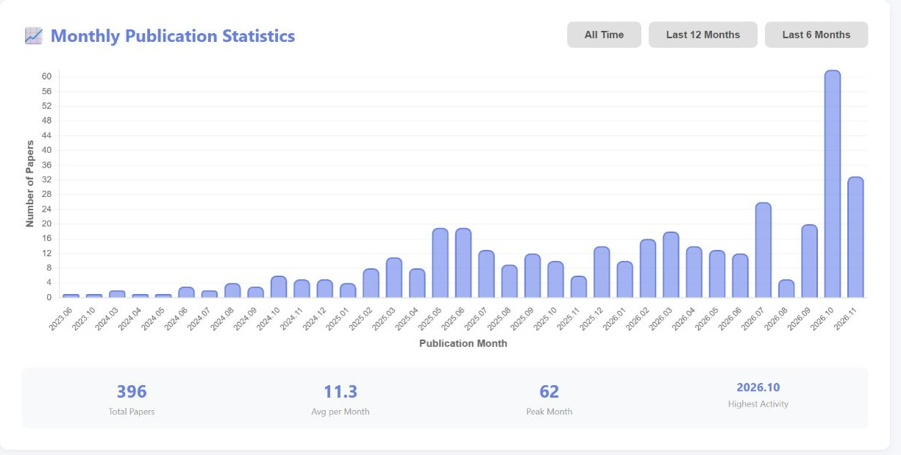

# News

> We continuously update the paper list in real time. If your work is unintentionally missing, please let us know by opening an issue. You are also welcome to cite  our survey to support this project.

### Recent Papers

<!-- START_RECENT_PAPERS -->
- **ELITE**: Evaluation-Free Recursive Self-Improvement for Coding Agents 
- **FlowPlan**: FlowPlan: Reducing the Token Cost of Coding Agents with Abstraction-Guided Planning and Verification 
- **Longtail-SWE**: Longtail-SWE: High-Quality SWE Tasks for Underrepresented Languages 
- **NINJA**: NINJA: A Navigator-Inspector Joint Architecture for Context-Efficient Issue Localization  
- **Robo-SWE**: Robo-SWE: An Executable Issue-Resolution Dataset Mined from Robot Software Repositories 
- **SWE-Growth**: SWE-growth: Teacher-Guided Adaptive Self-Play for Software Engineering Agents 
- **Compact-Bench**: Compact-Bench: Measuring What Context Compaction Costs Long-Horizon Coding Agents  
- **SWE-CC**: Correct Code, Broken Contributions? SWE-CC: Benchmarking Repository Policy Compliance for Coding Agents 
- **JevCoder**: JevCoder: When Does Decision Delegation Pay Off in Code Repair? 
- **SWE-Bench Pro V2**: SWE-Bench Pro V2: A Cleaner, Harder-to-Game Coding Benchmark 
- **SWE-DIVE**: SWE-DIVE: Multi-Turn Coding Agent Evaluation with Dynamic User Simulation  
- **Know Before Fix**: Know Before Fix: QA-Driven Repository Knowledge Acquisition for Software Issue Resolution 
- **Steer, Don't Solve**: Steer, Don't Solve: Training Small Critic Models for Large Code Agents   
<!-- END_RECENT_PAPERS -->

### Recent Updates

- **Survey Update (2026-11)**: Our collection has grown to **396 works** on LLM-based GitHub issue resolution, with **62 published in October alone**. Stay tuned for **v2 of our survey, coming soon~**

  

- **Survey Update (2026-08)**: Our repository now covers 281 papers on LLM-based GitHub issue resolution!
- **Survey Update (2026-03)**: Our repository now covers 200+ papers on LLM-based GitHub issue resolution!
- **Survey Update (2026-03)**: Added 21 new papers covering the latest advances in LLM-based issue resolution!
- **Survey Launch (2026-01)**: Our survey paper is now publicly available on arXiv: [https://arxiv.org/abs/2601.11655](https://arxiv.org/abs/2601.11655). It covers 175 papers and resources on LLM-based GitHub issue resolution, with continuously updated datasets and leaderboards!
